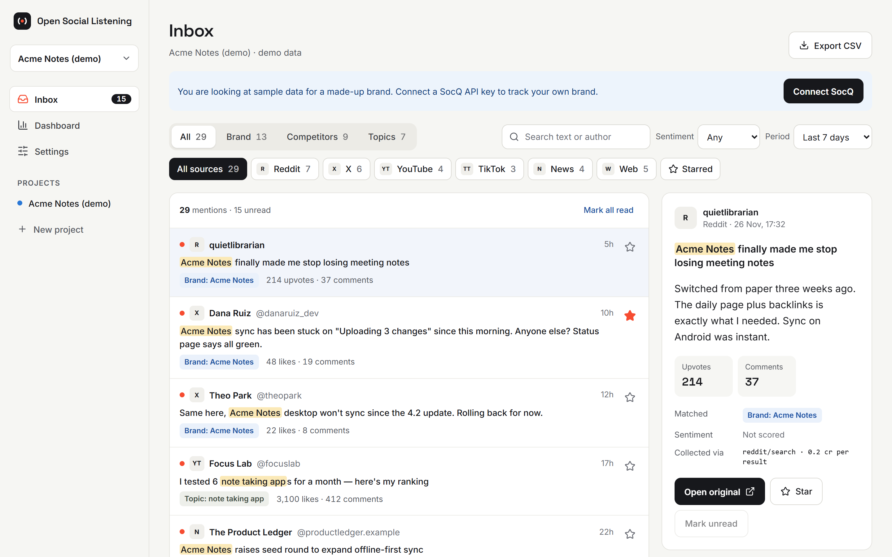
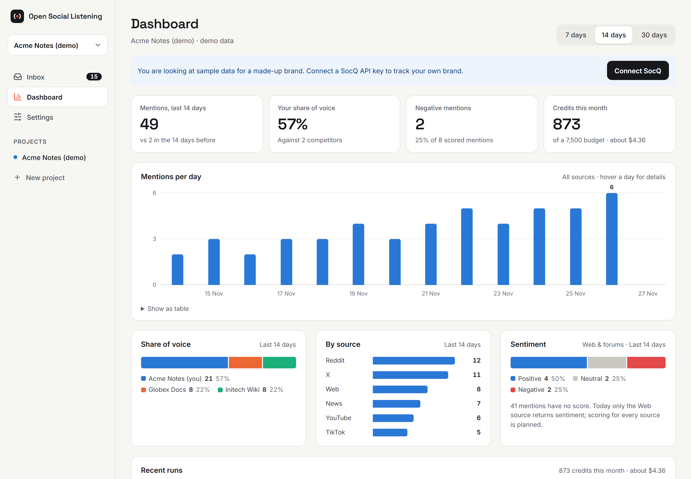
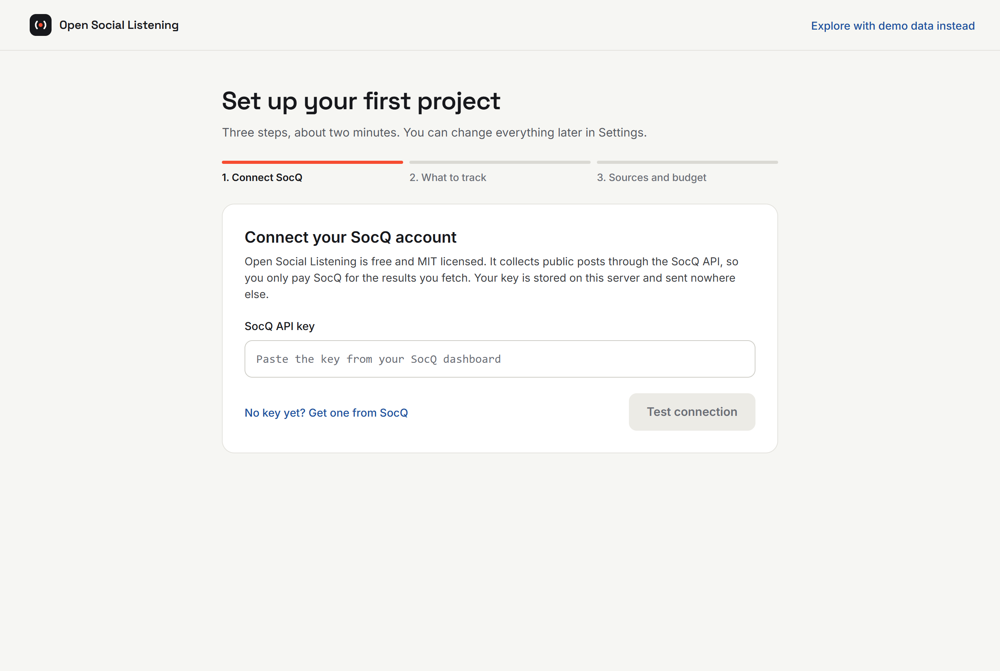

# Open Social Listening

[English](README.md) · [简体中文](README.zh-CN.md) · [日本語](README.ja.md) · **Deutsch** · [Bahasa Indonesia](README.id.md)

**Social Listening als Open Source, selbst gehostet.** Behalten Sie Ihre Marke, Ihre Wettbewerber und die Themen,
über die Ihre Kunden sprechen, im Blick: auf Reddit, X, YouTube, TikTok, Instagram, LinkedIn, Threads, Nachrichtenseiten
und im offenen Web, gesammelt in einem Posteingang, den Sie selbst betreiben.

Open Social Listening ist eine Open-Source-Alternative zu gehosteten Tools für Social-Media-Monitoring und
Markenüberwachung wie Brand24, Mention und Awario: MIT-lizenziert, Ihre Daten bleiben in einer SQLite-Datei auf Ihrem
Server, und es fallen keine monatlichen Gebühren pro Nutzer an. Die Beiträge werden über die
[SocQ-API](https://socq.ai/open-social-listening?utm_source=github&utm_medium=readme&utm_campaign=open-social-listening)
gesammelt, die pro Ergebnis abrechnet. Eine kleine Marke, die einmal am Tag geprüft wird, kostet so nur wenige Dollar im Monat.

**[Live-Demo ausprobieren](https://socqapi.github.io/open-social-listening/)**: die vollständige Oberfläche mit Beispieldaten einer erfundenen Marke, direkt in Ihrem Browser. Keine Installation, kein API-Schlüssel nötig.



## Funktionen

- **Ein Posteingang für alle Plattformen.** Erwähnungen aus allen Quellen landen in einer einzigen Liste mit
  Ungelesen-Status, Sternen, Volltextsuche und Filtern nach Quelle, Sentiment, Zeitraum und Treffer (Marke,
  Wettbewerber oder Thema).
- **Wettbewerber und Share of Voice.** Jeder Wettbewerber wird separat gesucht, damit das Dashboard zeigen kann,
  über wen wo gesprochen wird.
- **Läuft nach Zeitplan.** Jedes Projekt läuft alle 6 oder 12 Stunden, täglich oder wöchentlich. Wo die Plattform es
  unterstützt, durchsuchen die Abfragen nur dieses Zeitfenster, und Beiträge werden anhand ihrer URL dedupliziert.
  Sie zahlen also nie zweimal für denselben Beitrag.
- **Alarme bei Spitzen.** Bringt ein Durchlauf mehr als ein festgelegtes Vielfaches des 7-Tage-Durchschnitts, sendet
  die App eine Nachricht an Slack, Discord oder einen beliebigen Webhook oder verschickt eine E-Mail.
- **Budgetschutz.** Jedes Projekt hat ein monatliches Credit-Budget. Ein Durchlauf, der es überschreiten würde,
  pausiert das Projekt, statt mehr auszugeben. Ebenso wird es pausiert, wenn die Credits aufgebraucht sind oder der
  Schlüssel widerrufen wurde.
- **Export.** CSV oder JSON jeder gefilterten Ansicht, oder Sie lesen alles über die JSON-API aus.
- **Fünf Oberflächensprachen.** English, 简体中文, 日本語, Deutsch und Bahasa Indonesia. Die App folgt der Browsersprache
  und merkt sich Ihre Wahl.
- **Sentiment für Web- und Forenerwähnungen.** Erwähnungen aus der Quelle „Web“ erhalten eine positive, neutrale
  oder negative Bewertung. Die Bewertung von Social-Media-Beiträgen steht auf der Roadmap; bis dahin erscheinen sie
  als „Not scored“.



## Schnellstart

Sie benötigen Docker oder Node.js 22 oder neuer.

```bash
git clone https://github.com/SocQAPI/open-social-listening.git
cd open-social-listening
docker compose up -d          # http://localhost:3000, data in ./data
```

Öffnen Sie http://localhost:3000. Ohne API-Schlüssel zeigt die App dasselbe Demoprojekt wie die
[Live-Demo](https://socqapi.github.io/open-social-listening/), sodass Sie sich zuerst durch alle Ansichten klicken können. Wenn Sie echte Daten möchten, holen Sie sich einen Schlüssel in Ihrem
[SocQ-Dashboard](https://socq.ai/dashboard/api-key?utm_source=github&utm_medium=readme&utm_campaign=open-social-listening),
fügen Sie ihn im ersten Onboarding-Schritt ein und legen Sie dann fest, was die App beobachten soll.



Zum Ausprobieren ohne Docker startet `npm install && npm run dev` dieselbe App auf Port 3000. Für eine dauerhafte
Installation verwenden Sie das Docker-Image: Es wird mit `output: "standalone"` gebaut und enthält die statischen Dateien.

Ist die App aus dem Internet erreichbar, setzen Sie `OSL_PASSWORD`, damit jede Seite und jede API-Route danach fragt.

## Quellen und Kosten

Jeder Begriff, den Sie verfolgen, wird bei jedem Durchlauf zu einer Suche pro aktivierter Quelle. SocQ berechnet nur
die Ergebnisse, die tatsächlich zurückkommen, und die App zeigt Ihnen eine Schätzung, bevor Sie ein Projekt speichern.

| Quelle | SocQ-Endpunkt | Credits | Standardmäßig aktiv |
| --- | --- | --- | --- |
| Reddit | `reddit/search` | 0,2 pro Beitrag | ja |
| X | `x/search` | 0,7 pro Beitrag | ja |
| YouTube | `youtube/search` | 0,5 pro Video | ja |
| TikTok | `tiktok/search` | 0,7 pro Video | ja |
| Nachrichten | `seo/google-news` | 0,1 pro Artikel | ja |
| Web & Foren | `brand-monitoring/mentions` | 10 pro Suche + 0,02 pro Seite | ja |
| Instagram | `instagram/reels-search` | 0,5 pro Reel | nein |
| LinkedIn | `linkedin/search-posts` | 0,5 pro Beitrag | nein |
| Threads | `threads/search` | 0,6 pro Beitrag | nein |

Ein Credit kostet 0,005 $. Ein Rechenbeispiel: Ein Markenbegriff auf den sechs Standardquellen mit je 20 Ergebnissen,
einmal täglich abgefragt, kostet höchstens 54,4 Credits pro Durchlauf, also etwa 1.630 Credits (8 $) im Monat. Ruhige
Begriffe liefern weniger Ergebnisse und kosten weniger; die Schätzung ist eine Obergrenze.

Damit die Kosten niedrig und die Ergebnisse relevant bleiben, verfolgen Sie die Namen, die Menschen tatsächlich
schreiben („Acme Notes“, `@acmenotes`, `acmenotes.com`), statt eines einzelnen gängigen Wortes, und legen Sie
Ausschlussbegriffe für fremde Bedeutungen an. Ausschlussbegriffe erzeugen keine zusätzlichen Suchen; sie blenden
passende Beiträge nach dem Sammeln aus.

## Konfiguration

Alle Einstellungen sind optional. Tragen Sie sie für Docker in `.env` ein, für `npm run dev` in `.env.local`
(siehe [.env.example](.env.example)).

| Variable | Zweck |
| --- | --- |
| `SOCQ_API_KEY` | SocQ-API-Schlüssel. Hat Vorrang vor dem Schlüssel, der auf der Seite „Settings“ gespeichert ist. |
| `SOCQ_API_BASE` | Basis-URL der SocQ-API, Standard `https://api.socq.ai`. |
| `DATABASE_URL` | libsql-URL, Standard `file:./data/osl.db` (SQLite). `DATABASE_AUTH_TOKEN` für eine entfernte libsql/Turso-Datenbank. |
| `OSL_PASSWORD` | Wenn gesetzt, verlangt jede Seite und jede API-Route HTTP Basic Auth mit diesem Passwort. |
| `SMTP_URL`, `ALERT_FROM` | SMTP-Verbindungs-URL und Absenderadresse für E-Mail-Alarme. |
| `OSL_DISABLE_SCHEDULER` | `1` deaktiviert den integrierten Scheduler; „Run now“ funktioniert weiterhin. |

Der API-Schlüssel wird in Ihrer Datenbank gespeichert und ausschließlich an die SocQ-API gesendet.

## Funktionsweise

- **Quellen** (`lib/sources/`): eine Datei pro SocQ-Suchendpunkt. Jede baut die Anfrage (Ergebnislimit, Zeitfenster,
  Sortierung) und bildet die normalisierten Datensätze von SocQ auf eine Erwähnung ab.
- **Runner** (`lib/runner.ts`): Für jede aktivierte Quelle und jeden Begriff übermittelt er einen SocQ-Task, fragt
  dessen Status ab, speichert neue Erwähnungen (eindeutig pro Projekt und URL), erfasst die berechneten Credits und
  verschickt Spitzen-Alarme. Ein 401 pausiert das Projekt (`auth`), ein 402 ebenfalls (`credits`), und ein Durchlauf,
  der das Monatsbudget überschreiten würde, pausiert es auch (`budget`).
- **Scheduler** (`lib/scheduler.ts`): wird aus `instrumentation.ts` gestartet und führt jede Minute die Projekte aus,
  deren Intervall abgelaufen ist.
- **Alarme** (`lib/alerts.ts`): Ein Durchlauf löst in einem Kanal einen Alarm aus, wenn seine neuen Erwähnungen den
  Multiplikator des Kanals mal den Durchschnitt der letzten 7 Tage übersteigen (dafür sind mindestens drei frühere
  Durchläufe nötig).
- **Kosten** (`lib/cost.ts`): Schätzungen pro Durchlauf und pro Monat auf Basis der SocQ-Preise pro Ergebnis.
- **Speicher** (`db/`): Drizzle ORM über libsql/SQLite. Die Migrationen liegen als SQL in `db/migrations.ts` und
  werden beim Start angewendet.

### API

| Route | Zweck |
| --- | --- |
| `GET/POST /api/projects` | Projekte auflisten oder anlegen |
| `GET/PATCH/DELETE /api/projects/:id` | Projekt lesen, aktualisieren (einschließlich `paused`) oder löschen |
| `POST /api/projects/:id/run` | Sofort einen Durchlauf starten (202, läuft im Hintergrund) |
| `GET/POST /api/projects/:id/alerts`, `PATCH/DELETE /api/alerts/:id`, `POST /api/alerts/:id/test` | Alarmkanäle |
| `GET /api/mentions` | Gefilterte Erwähnungen mit Cursor-Paginierung |
| `PATCH /api/mentions/:id`, `POST /api/mentions/mark-read` | Stern und Gelesen-Status |
| `GET /api/stats` | Tägliches Volumen, Share of Voice, Sentiment, Credits, letzte Durchläufe |
| `GET /api/export` | Download als CSV oder JSON |
| `GET/PUT /api/settings`, `GET /api/account` | API-Schlüssel und SocQ-Guthaben |
| `POST /api/estimate` | Credit-Schätzung für einen Projektentwurf |

## Statische Demo

`npm run build:demo -- /open-social-listening` baut die schreibgeschützte Demo nach `out/`, die
[ein Workflow](.github/workflows/pages.yml) auf GitHub Pages veröffentlicht. Es handelt sich um einen statischen Export:
Dieselben API-Route-Handler laufen im Browser auf einer In-Memory-SQLite-Datenbank ([sql.js](https://sql.js.org)),
die mit dem Demoprojekt befüllt ist. Lesen, Filtern, Markieren mit Stern und Exportieren funktionieren also; alles,
was Einstellungen speichern, SocQ aufrufen oder Alarme senden würde, weist darauf hin, dass die Demo schreibgeschützt ist.

## Entwicklung

```bash
npm install
npm run dev          # http://localhost:3000
npm test             # unit and integration tests (vitest)
npm run typecheck
```

Stack: Next.js 16, React 19, Tailwind CSS 4, Drizzle ORM mit libsql. Die CI baut das Docker-Image und prüft jede
Seite dagegen.

## Roadmap

- Sentiment-Bewertungen für Social-Media-Beiträge, nicht nur für Web- und Forenerwähnungen
- Weitere Quellen, sobald SocQ neue Suchendpunkte hinzufügt

Issues und Pull Requests sind willkommen.

## Lizenz

[MIT](LICENSE). Entwickelt vom Team hinter [SocQ](https://socq.ai/?utm_source=github&utm_medium=readme&utm_campaign=open-social-listening).
