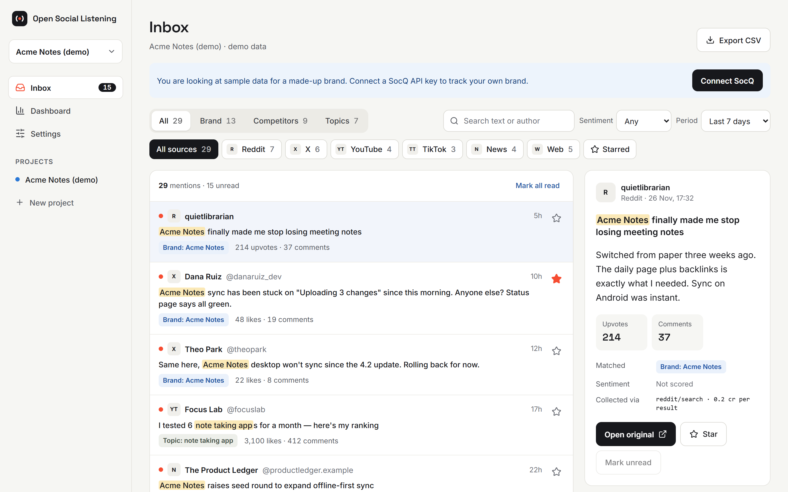
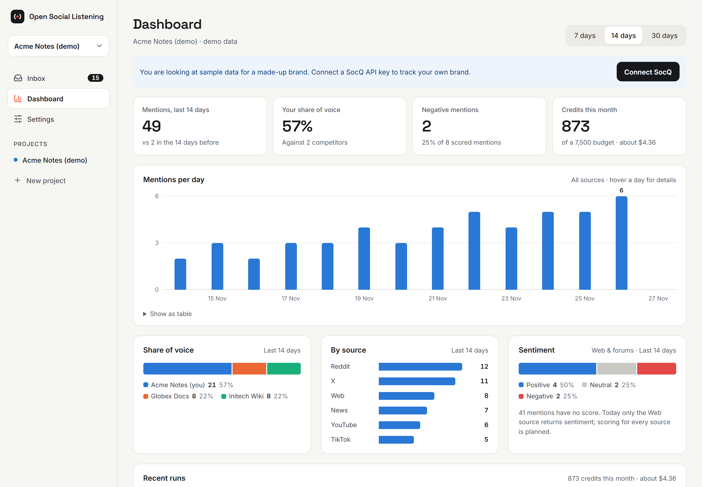
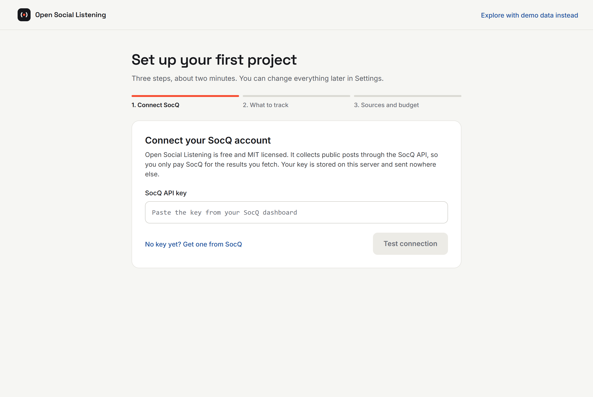

# Open Social Listening

[English](README.md) · [简体中文](README.zh-CN.md) · [日本語](README.ja.md) · [Deutsch](README.de.md) · **Bahasa Indonesia**

**Social listening open-source yang self-hosted.** Pantau brand Anda, kompetitor, dan topik yang dibicarakan calon
pembeli Anda di Reddit, X, YouTube, TikTok, Instagram, LinkedIn, Threads, situs berita, dan web terbuka, semuanya
dalam satu kotak masuk yang Anda jalankan sendiri.

Ini adalah alternatif open-source untuk layanan hosted seperti Brand24, Mention, dan Awario: berlisensi MIT, data
Anda tetap tersimpan di file SQLite di server Anda, dan tidak ada biaya langganan bulanan per pengguna. Postingan
dikumpulkan melalui
[SocQ API](https://socq.ai/open-social-listening?utm_source=github&utm_medium=readme&utm_campaign=open-social-listening),
yang menagih per hasil, sehingga brand kecil yang dicek sekali sehari hanya menghabiskan beberapa dolar per bulan.

**[Coba demo langsung](https://socqapi.github.io/open-social-listening/)**: antarmuka lengkap dengan data contoh untuk brand fiktif, berjalan di browser Anda. Tidak perlu instalasi dan tidak perlu API key.



## Fitur

- **Satu kotak masuk untuk semua platform.** Mention dari semua sumber masuk ke satu daftar, lengkap dengan status
  belum dibaca, bintang, pencarian teks penuh, dan filter berdasarkan sumber, sentimen, periode, serta hal yang
  cocok (brand, kompetitor, atau topik).
- **Kompetitor dan share of voice.** Setiap kompetitor dicari secara terpisah, sehingga dasbor bisa menunjukkan
  siapa yang paling banyak dibicarakan dan di mana.
- **Berjalan sesuai jadwal.** Setiap proyek dijalankan tiap 6 atau 12 jam, harian, atau mingguan. Jika platform
  mendukungnya, pencarian hanya melihat ke belakang sepanjang rentang waktu itu, dan postingan dideduplikasi
  berdasarkan URL, jadi Anda tidak pernah membayar dua kali untuk postingan yang sama.
- **Peringatan lonjakan.** Saat satu eksekusi menghasilkan lebih dari kelipatan tertentu dari rata-rata 7 hari,
  aplikasi akan mengirim notifikasi ke Slack, Discord, webhook apa pun, atau lewat email.
- **Pengaman anggaran.** Setiap proyek punya anggaran kredit bulanan. Eksekusi yang akan melampauinya akan menjeda
  proyek alih-alih terus membelanjakan kredit. Proyek juga dijeda jika kredit habis atau API key dicabut.
- **Ekspor.** CSV atau JSON dari tampilan apa pun yang sudah difilter, atau baca semuanya melalui JSON API.
- **Sentimen untuk mention dari web dan forum.** Mention dari sumber Web dilengkapi skor positif, netral, atau
  negatif. Penilaian untuk postingan media sosial masuk dalam roadmap; sampai saat itu postingan tersebut
  ditampilkan sebagai "Not scored" (belum dinilai).



## Mulai cepat

Anda membutuhkan Docker, atau Node.js 22 atau yang lebih baru.

```bash
git clone https://github.com/SocQAPI/open-social-listening.git
cd open-social-listening
docker compose up -d          # http://localhost:3000, data in ./data
```

Buka http://localhost:3000. Tanpa API key, aplikasi menampilkan proyek demo yang sama dengan
[demo langsung](https://socqapi.github.io/open-social-listening/), jadi Anda bisa menjelajahi setiap layar terlebih dahulu. Saat Anda menginginkan data sungguhan, ambil key dari
[dasbor SocQ](https://socq.ai/dashboard/api-key?utm_source=github&utm_medium=readme&utm_campaign=open-social-listening)
Anda, tempelkan di langkah pertama onboarding, lalu beri tahu aplikasi apa yang ingin Anda pantau.



Untuk mencobanya tanpa Docker, `npm install && npm run dev` menjalankan aplikasi yang sama di port 3000. Untuk
instalasi jangka panjang, gunakan image Docker: image ini dibangun dari `output: "standalone"` dan sudah menyertakan
file statis.

Jika aplikasi bisa diakses dari internet, atur `OSL_PASSWORD` agar setiap halaman dan route API meminta kata sandi
tersebut.

## Sumber dan biaya

Setiap kata kunci yang Anda pantau menjadi satu pencarian per sumber aktif di setiap eksekusi. SocQ hanya menagih
hasil yang dikembalikannya, dan aplikasi menampilkan estimasi biaya sebelum Anda menyimpan proyek.

| Sumber | Endpoint SocQ | Kredit | Aktif secara default |
| --- | --- | --- | --- |
| Reddit | `reddit/search` | 0,2 per postingan | ya |
| X | `x/search` | 0,7 per postingan | ya |
| YouTube | `youtube/search` | 0,5 per video | ya |
| TikTok | `tiktok/search` | 0,7 per video | ya |
| Berita | `seo/google-news` | 0,1 per artikel | ya |
| Web & forum | `brand-monitoring/mentions` | 10 per pencarian + 0,02 per halaman | ya |
| Instagram | `instagram/reels-search` | 0,5 per reel | tidak |
| LinkedIn | `linkedin/search-posts` | 0,5 per postingan | tidak |
| Threads | `threads/search` | 0,6 per postingan | tidak |

Satu kredit setara dengan $0,005. Contoh perhitungan: satu kata kunci brand di enam sumber default, masing-masing
20 hasil, sekali sehari, paling banyak 54,4 kredit per eksekusi, atau sekitar 1.630 kredit ($8) per bulan. Kata
kunci yang jarang dibicarakan menghasilkan lebih sedikit hasil dan biayanya lebih rendah; estimasi ini adalah batas
atas.

Agar biaya tetap rendah dan hasilnya relevan, pantau nama yang benar-benar ditulis orang (“Acme Notes”, `@acmenotes`,
`acmenotes.com`), bukan satu kata umum, dan tambahkan kata kunci pengecualian untuk makna yang tidak berkaitan. Kata
kunci pengecualian tidak menambah pencarian; kata kunci ini hanya menyembunyikan postingan yang cocok setelah
dikumpulkan.

## Konfigurasi

Semua pengaturan bersifat opsional. Letakkan di `.env` untuk Docker atau `.env.local` untuk `npm run dev`
(lihat [.env.example](.env.example)).

| Variabel | Fungsi |
| --- | --- |
| `SOCQ_API_KEY` | API key SocQ. Menggantikan key yang disimpan di halaman Settings. |
| `SOCQ_API_BASE` | Base URL SocQ API, default `https://api.socq.ai`. |
| `DATABASE_URL` | URL libsql, default `file:./data/osl.db` (SQLite). `DATABASE_AUTH_TOKEN` untuk database libsql/Turso jarak jauh. |
| `OSL_PASSWORD` | Jika diatur, setiap halaman dan route API memerlukan HTTP basic auth dengan kata sandi ini. |
| `SMTP_URL`, `ALERT_FROM` | URL koneksi SMTP dan alamat pengirim untuk peringatan via email. |
| `OSL_DISABLE_SCHEDULER` | `1` menghentikan penjadwal bawaan; “Run now” tetap berfungsi. |

API key disimpan di database Anda dan hanya dikirim ke SocQ API.

## Cara kerja

- **Sources** (`lib/sources/`): satu file per endpoint pencarian SocQ. Setiap file menyusun request (batas jumlah
  hasil, rentang waktu, urutan) dan memetakan record SocQ yang sudah dinormalisasi menjadi mention.
- **Runner** (`lib/runner.ts`): untuk setiap sumber aktif dan kata kunci, runner mengirim task SocQ, melakukan
  polling, menyimpan mention baru (unik per proyek dan URL), mencatat kredit yang ditagih, dan mengirim peringatan
  lonjakan. Respons 401 menjeda proyek (`auth`), 402 menjedanya (`credits`), dan eksekusi yang akan melampaui
  anggaran bulanan juga menjedanya (`budget`).
- **Scheduler** (`lib/scheduler.ts`): dijalankan dari `instrumentation.ts`; setiap menit, scheduler menjalankan
  proyek yang intervalnya sudah lewat.
- **Alerts** (`lib/alerts.ts`): sebuah eksekusi memicu peringatan ke suatu kanal jika jumlah mention barunya melebihi
  pengali kanal tersebut dikali rata-rata 7 hari terakhir (minimal diperlukan tiga eksekusi sebelumnya).
- **Costs** (`lib/cost.ts`): estimasi per eksekusi dan per bulan berdasarkan harga per hasil dari SocQ.
- **Storage** (`db/`): Drizzle ORM di atas libsql/SQLite. Migrasi berupa SQL di `db/migrations.ts` dan diterapkan
  saat aplikasi dijalankan.

### API

| Route | Fungsi |
| --- | --- |
| `GET/POST /api/projects` | Menampilkan daftar atau membuat proyek |
| `GET/PATCH/DELETE /api/projects/:id` | Membaca, memperbarui (termasuk `paused`), atau menghapus proyek |
| `POST /api/projects/:id/run` | Memulai eksekusi sekarang (202, berjalan di latar belakang) |
| `GET/POST /api/projects/:id/alerts`, `PATCH/DELETE /api/alerts/:id`, `POST /api/alerts/:id/test` | Kanal peringatan |
| `GET /api/mentions` | Mention yang sudah difilter, dengan paginasi berbasis cursor |
| `PATCH /api/mentions/:id`, `POST /api/mentions/mark-read` | Status bintang dan sudah dibaca |
| `GET /api/stats` | Volume harian, share of voice, sentimen, kredit, eksekusi terbaru |
| `GET /api/export` | Unduhan CSV atau JSON |
| `GET/PUT /api/settings`, `GET /api/account` | API key dan saldo SocQ |
| `POST /api/estimate` | Estimasi kredit untuk draf proyek |

## Demo statis

`npm run build:demo -- /open-social-listening` membangun demo read-only ke `out/`, yang kemudian dipublikasikan ke
GitHub Pages oleh [sebuah workflow](.github/workflows/pages.yml). Ini adalah ekspor statis: handler route API yang
sama berjalan di browser di atas database SQLite in-memory ([sql.js](https://sql.js.org)) yang sudah diisi proyek
demo, sehingga membaca, memfilter, memberi bintang, dan mengekspor tetap berfungsi, sedangkan tindakan yang akan
menyimpan pengaturan, memanggil SocQ, atau mengirim peringatan akan menampilkan penjelasan bahwa demo ini read-only.

## Pengembangan

```bash
npm install
npm run dev          # http://localhost:3000
npm test             # unit and integration tests (vitest)
npm run typecheck
```

Stack: Next.js 16, React 19, Tailwind CSS 4, Drizzle ORM dengan libsql. CI membangun image Docker dan memeriksa
setiap halaman terhadap image tersebut.

## Roadmap

- Skor sentimen untuk postingan media sosial, tidak hanya mention dari web dan forum
- Lebih banyak sumber seiring SocQ menambah endpoint pencarian

Issue dan pull request sangat kami sambut.

## Lisensi

[MIT](LICENSE). Dibuat oleh tim di balik [SocQ](https://socq.ai/?utm_source=github&utm_medium=readme&utm_campaign=open-social-listening).
