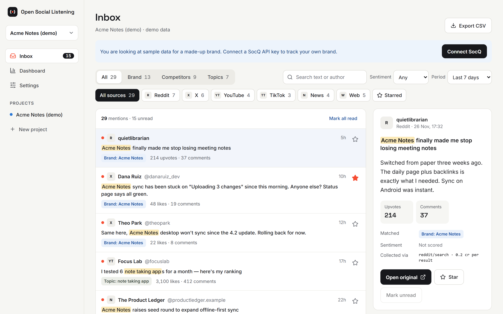
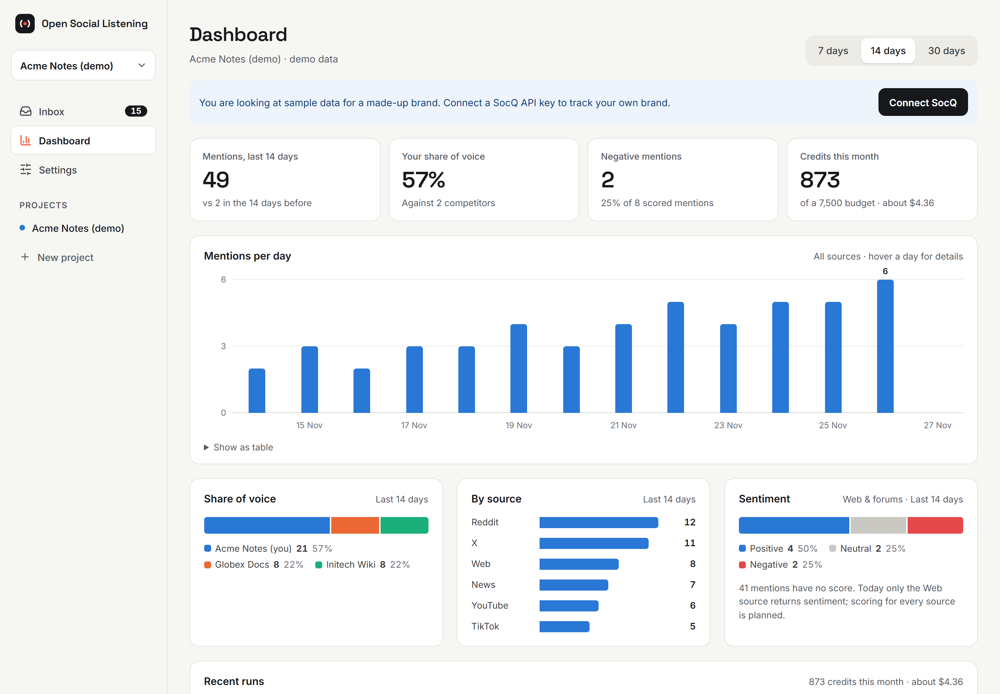
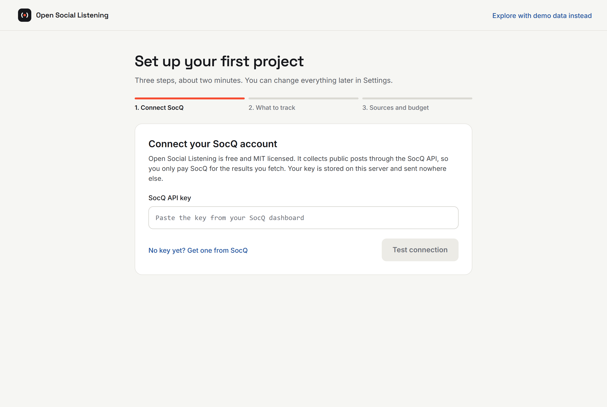

# Open Social Listening

[English](README.md) · [简体中文](README.zh-CN.md) · **日本語** · [Deutsch](README.de.md) · [Bahasa Indonesia](README.id.md)

**オープンソースでセルフホスト型のソーシャルリスニングツールです。** 自社ブランド、競合、そして顧客が話題にしているテーマを、Reddit、X、YouTube、TikTok、Instagram、LinkedIn、Threads、ニュースサイト、一般のウェブから追跡し、自分で運用するひとつのインボックスにまとめます。エゴサーチやブランドモニタリング、SNS分析を自分の環境で完結できます。

Brand24、Mention、Awarioなどのクラウド型ツールに代わるオープンソースの選択肢です。MITライセンスで、データは自分のサーバー上のSQLiteファイルに保存され、ユーザー数に応じた月額料金もかかりません。投稿の収集には
[SocQ API](https://socq.ai/open-social-listening?utm_source=github&utm_medium=readme&utm_campaign=open-social-listening)
を使います。SocQ APIは取得した結果の件数に応じた従量課金なので、小規模なブランドを1日1回チェックする程度なら月数ドルで済みます。

**[ライブデモを試す](https://socqapi.github.io/open-social-listening/)**：架空のブランドのサンプルデータを使い、すべての画面がブラウザ上で動きます。インストールもAPIキーも不要です。



## 主な機能

- **すべてのプラットフォームをひとつのインボックスに。** すべてのソースからのメンション（言及）がひとつのリストに集まります。未読管理、スター、全文検索に加え、ソース、感情、期間、マッチした対象（ブランド、競合、トピック）で絞り込めます。
- **競合分析とシェア・オブ・ボイス。** 競合ごとに個別に検索するので、誰がどこで話題になっているかをダッシュボードで確認できます。
- **スケジュール実行。** プロジェクトごとに6時間または12時間ごと、毎日、毎週のいずれかで実行します。プラットフォームが対応していれば検索はその間隔の分だけさかのぼり、投稿はURLで重複排除されるので、同じ投稿に二重に料金を払うことはありません。
- **急増アラート。** 1回の実行で取得した件数が直近7日間の平均の設定倍率を超えると、Slack、Discord、任意のWebhookに通知するか、メールを送ります。
- **予算ガード。** プロジェクトごとに月間のクレジット予算を設定します。予算を超えそうな実行は、それ以上消費せずにプロジェクトを一時停止します。クレジットが尽きたときやAPIキーが無効になったときも一時停止します。
- **エクスポート。** 絞り込んだ任意のビューをCSVまたはJSONで書き出せます。JSON APIからすべてのデータを読み出すこともできます。
- **ウェブとフォーラムのメンションに感情分析。** Webソースからのメンションには、ポジティブ、ニュートラル、ネガティブのスコアが付きます。SNS投稿のスコアリングはロードマップにあり、対応するまでは「Not scored」と表示されます。



## クイックスタート

Docker、またはNode.js 22以降が必要です。

```bash
git clone https://github.com/SocQAPI/open-social-listening.git
cd open-social-listening
docker compose up -d          # http://localhost:3000, data in ./data
```

http://localhost:3000 を開きます。APIキーを設定していない状態では
[ライブデモ](https://socqapi.github.io/open-social-listening/)と同じデモプロジェクトが表示されるので、まずはすべての画面を操作してみてください。実際のデータを使いたくなったら、
[SocQダッシュボード](https://socq.ai/dashboard/api-key?utm_source=github&utm_medium=readme&utm_campaign=open-social-listening)
でキーを取得してオンボーディングの最初のステップに貼り付け、何を監視するかをアプリに設定します。



Dockerを使わずに試す場合は、`npm install && npm run dev`で同じアプリがポート3000で起動します。常時稼働させる場合はDockerイメージを使ってください。イメージは`output: "standalone"`でビルドされ、静的ファイルも含まれています。

アプリをインターネットに公開する場合は、`OSL_PASSWORD`を設定してください。すべてのページとAPIルートでパスワードが求められるようになります。

## ソースと料金

追跡する語句はそれぞれ、実行のたびに有効なソースごとに1回検索されます。SocQが課金するのは返された結果の分だけで、プロジェクトを保存する前にアプリが見積もりを表示します。

| ソース | SocQエンドポイント | クレジット | デフォルトで有効 |
| --- | --- | --- | --- |
| Reddit | `reddit/search` | 投稿1件あたり0.2 | はい |
| X | `x/search` | 投稿1件あたり0.7 | はい |
| YouTube | `youtube/search` | 動画1本あたり0.5 | はい |
| TikTok | `tiktok/search` | 動画1本あたり0.7 | はい |
| ニュース | `seo/google-news` | 記事1件あたり0.1 | はい |
| ウェブとフォーラム | `brand-monitoring/mentions` | 検索1回あたり10 + ページ1件あたり0.02 | はい |
| Instagram | `instagram/reels-search` | リール1本あたり0.5 | いいえ |
| LinkedIn | `linkedin/search-posts` | 投稿1件あたり0.5 | いいえ |
| Threads | `threads/search` | 投稿1件あたり0.6 | いいえ |

1クレジットは$0.005です。計算例：ブランド名1つをデフォルトの6ソースで、各20件ずつ1日1回取得する場合、1回の実行で最大54.4クレジット、月に約1,630クレジット（$8）です。話題になることが少ない語句は結果が少なく、料金も下がります。見積もりはあくまで上限値です。

コストを抑えて関連性の高い結果を得るには、ありふれた単語ひとつではなく、実際に書き込まれる名前（「Acme Notes」、`@acmenotes`、`acmenotes.com`）を追跡し、無関係な意味を除くための除外語を追加してください。除外語で検索回数は増えません。収集した後に、一致する投稿を非表示にするだけです。

## 設定

設定はすべて任意です。Dockerの場合は`.env`、`npm run dev`の場合は`.env.local`に記述します
（[.env.example](.env.example)を参照）。

| 変数 | 用途 |
| --- | --- |
| `SOCQ_API_KEY` | SocQのAPIキー。Settingsページで保存したキーより優先されます。 |
| `SOCQ_API_BASE` | SocQ APIのベースURL。デフォルトは`https://api.socq.ai`です。 |
| `DATABASE_URL` | libsqlのURL。デフォルトは`file:./data/osl.db`（SQLite）です。リモートのlibsql/Tursoデータベースを使う場合は`DATABASE_AUTH_TOKEN`も設定します。 |
| `OSL_PASSWORD` | 設定すると、すべてのページとAPIルートで、このパスワードによるHTTP Basic認証が必要になります。 |
| `SMTP_URL`、`ALERT_FROM` | メールアラート用のSMTP接続URLと送信元アドレス。 |
| `OSL_DISABLE_SCHEDULER` | `1`にすると組み込みのスケジューラーを停止します。「Run now」は引き続き使えます。 |

APIキーはデータベースに保存され、SocQ API以外には送信されません。

## 仕組み

- **ソース**（`lib/sources/`）：SocQの検索エンドポイントごとに1ファイルです。それぞれがリクエスト（取得件数の上限、期間、並び順）を組み立て、SocQの正規化されたレコードをメンションに変換します。
- **ランナー**（`lib/runner.ts`）：有効なソースと語句ごとにSocQのタスクを送信してポーリングし、新しいメンションを保存（プロジェクトとURLの組み合わせで一意）、消費したクレジットを記録して、急増アラートを送ります。401が返るとプロジェクトを一時停止し（`auth`）、402でも一時停止します（`credits`）。月間予算を超える実行も一時停止の対象です（`budget`）。
- **スケジューラー**（`lib/scheduler.ts`）：`instrumentation.ts`から起動され、1分ごとに実行間隔が経過したプロジェクトを実行します。
- **アラート**（`lib/alerts.ts`）：新しいメンション数が、直近7日間の平均にチャネルの倍率を掛けた値を超えると、そのチャネルに通知します（それ以前に3回以上の実行が必要です）。
- **コスト**（`lib/cost.ts`）：SocQの結果単価をもとに、実行ごと・月ごとの見積もりを算出します。
- **ストレージ**（`db/`）：libsql/SQLite上でDrizzle ORMを使います。マイグレーションは`db/migrations.ts`にSQLで記述されており、起動時に適用されます。

### API

| ルート | 用途 |
| --- | --- |
| `GET/POST /api/projects` | プロジェクトの一覧取得・作成 |
| `GET/PATCH/DELETE /api/projects/:id` | プロジェクトの取得、更新（`paused`を含む）、削除 |
| `POST /api/projects/:id/run` | 今すぐ実行を開始（202を返し、バックグラウンドで実行） |
| `GET/POST /api/projects/:id/alerts`, `PATCH/DELETE /api/alerts/:id`, `POST /api/alerts/:id/test` | アラートチャネル |
| `GET /api/mentions` | 絞り込み済み・カーソル方式でページングされたメンション |
| `PATCH /api/mentions/:id`, `POST /api/mentions/mark-read` | スターと既読状態 |
| `GET /api/stats` | 日別の件数、シェア・オブ・ボイス、感情、クレジット、最近の実行 |
| `GET /api/export` | CSVまたはJSONのダウンロード |
| `GET/PUT /api/settings`, `GET /api/account` | APIキーとSocQの残高 |
| `POST /api/estimate` | プロジェクト下書きのクレジット見積もり |

## 静的デモ

`npm run build:demo -- /open-social-listening`で読み取り専用のデモを`out/`にビルドし、
[ワークフロー](.github/workflows/pages.yml)がGitHub Pagesに公開します。これは静的エクスポートで、同じAPIルートハンドラーが、デモプロジェクトを投入したインメモリのSQLiteデータベース（[sql.js](https://sql.js.org)）を使ってブラウザ上で動きます。そのため閲覧、絞り込み、スター付け、エクスポートは動作し、設定の保存やSocQの呼び出し、アラートの送信が必要な操作では、デモが読み取り専用である旨が表示されます。

## 開発

```bash
npm install
npm run dev          # http://localhost:3000
npm test             # unit and integration tests (vitest)
npm run typecheck
```

技術スタック：Next.js 16、React 19、Tailwind CSS 4、Drizzle ORM（libsql）。CIではDockerイメージをビルドし、そのイメージに対してすべてのページをチェックしています。

## ロードマップ

- ウェブとフォーラムのメンションだけでなく、SNS投稿にも感情スコアを付ける
- SocQの検索エンドポイントの追加に合わせてソースを増やす

IssueやPull Requestを歓迎します。

## ライセンス

[MIT](LICENSE)。[SocQ](https://socq.ai/?utm_source=github&utm_medium=readme&utm_campaign=open-social-listening)の開発チームが作っています。
