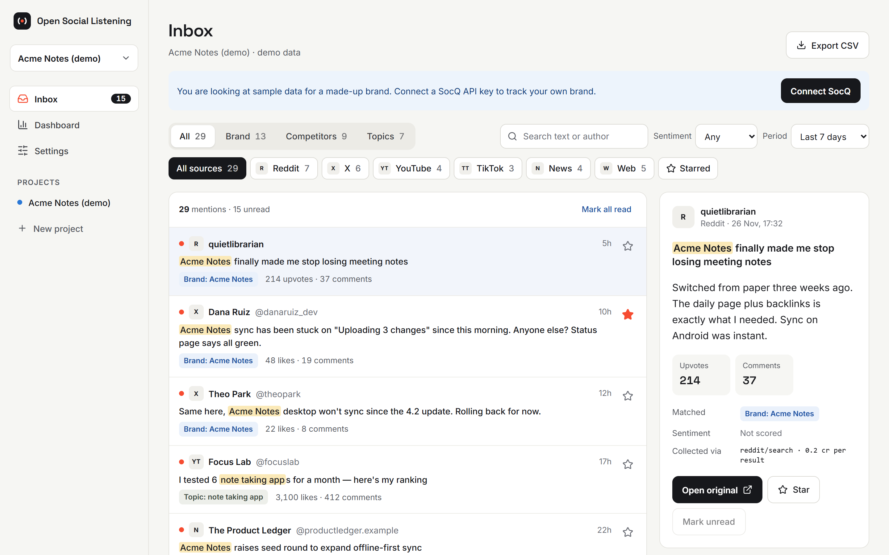
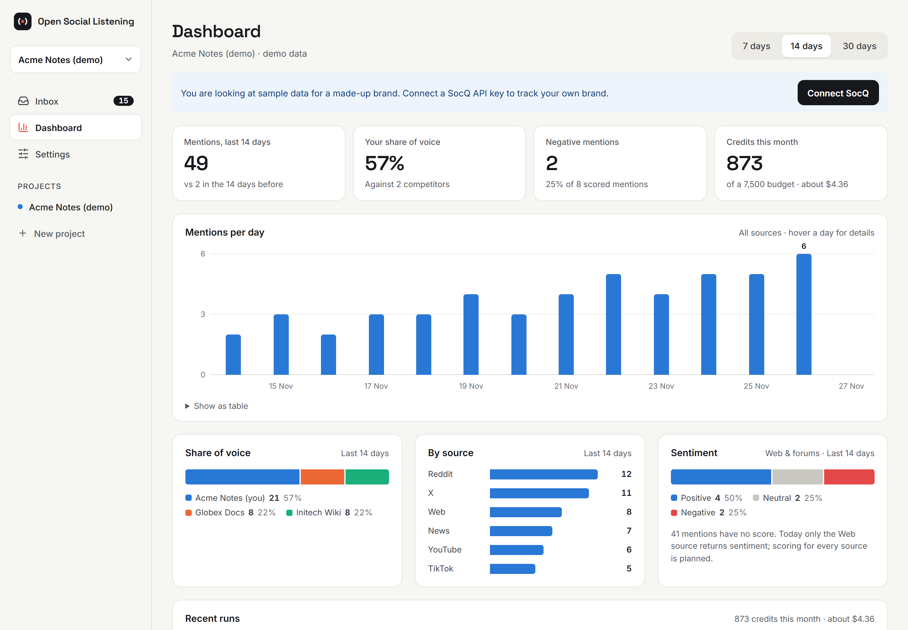
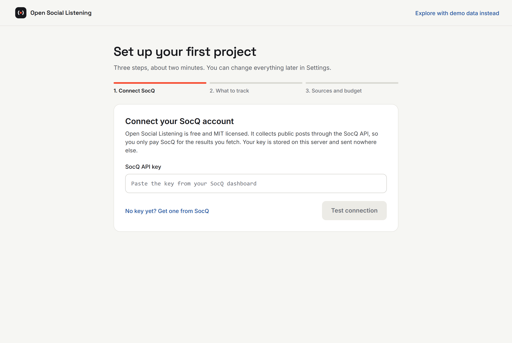

# Open Social Listening

**English** · [简体中文](README.zh-CN.md) · [日本語](README.ja.md) · [Deutsch](README.de.md) · [Bahasa Indonesia](README.id.md)

**Open-source, self-hosted social listening.** Track your brand, your competitors and the topics your buyers
talk about across Reddit, X, YouTube, TikTok, Instagram, LinkedIn, Threads, news sites and the open web, in one
inbox you run yourself.

It is an open-source alternative to hosted tools like Brand24, Mention and Awario: MIT licensed, your data stays
in a SQLite file on your server, and there is no monthly seat price. Posts are collected through the
[SocQ API](https://socq.ai/open-social-listening?utm_source=github&utm_medium=readme&utm_campaign=open-social-listening),
which bills per result, so a small brand checked once a day costs a few dollars a month.

**[Try the live demo](https://socqapi.github.io/open-social-listening/)**: the full interface with sample data for a made-up brand, running in your browser. Nothing to install, and no API key needed.



## What it does

- **One inbox for every platform.** Mentions from all sources land in a single list with unread state, stars,
  full-text search and filters by source, sentiment, period and what matched (brand, competitor or topic).
- **Competitors and share of voice.** Each competitor is searched on its own, so the dashboard can show who gets
  talked about and where.
- **Runs on a schedule.** Each project runs every 6 or 12 hours, daily or weekly. Searches only look back over that window
  where the platform supports it, and posts are de-duplicated by URL, so you never pay twice for the same post.
- **Spike alerts.** When a run brings in more than a set multiple of the 7-day average, the app posts to Slack,
  Discord, any webhook, or sends an email.
- **Budget guard.** Each project has a monthly credit budget. A run that would go over it pauses the project
  instead of spending more. Runs out of credits or with a revoked key pause it too.
- **Export.** CSV or JSON of any filtered view, or read everything through the JSON API.
- **Sentiment on web and forum mentions.** Mentions from the Web source come with positive, neutral or negative
  scores. Scoring for social posts is on the roadmap; until then they show as "Not scored".



## Quick start

You need Docker, or Node.js 22 or newer.

```bash
git clone https://github.com/SocQAPI/open-social-listening.git
cd open-social-listening
docker compose up -d          # http://localhost:3000, data in ./data
```

Open http://localhost:3000. Without an API key the app shows the same demo project as the
[live demo](https://socqapi.github.io/open-social-listening/), so you can click through every screen first. When you want real data, get a key from your
[SocQ dashboard](https://socq.ai/dashboard/api-key?utm_source=github&utm_medium=readme&utm_campaign=open-social-listening),
paste it on the first onboarding step, then tell the app what to listen for.



To try it without Docker, `npm install && npm run dev` serves the same app on port 3000. For a long-running
install, use the Docker image: it is built from `output: "standalone"` and includes the static files.

If the app is reachable from the internet, set `OSL_PASSWORD` so every page and API route asks for it.

## Sources and costs

Every term you track becomes one search per enabled source on each run. SocQ charges only for the results it
returns, and the app shows an estimate before you save a project.

| Source | SocQ endpoint | Credits | On by default |
| --- | --- | --- | --- |
| Reddit | `reddit/search` | 0.2 per post | yes |
| X | `x/search` | 0.7 per post | yes |
| YouTube | `youtube/search` | 0.5 per video | yes |
| TikTok | `tiktok/search` | 0.7 per video | yes |
| News | `seo/google-news` | 0.1 per article | yes |
| Web & forums | `brand-monitoring/mentions` | 10 per search + 0.02 per page | yes |
| Instagram | `instagram/reels-search` | 0.5 per reel | no |
| LinkedIn | `linkedin/search-posts` | 0.5 per post | no |
| Threads | `threads/search` | 0.6 per post | no |

One credit is $0.005. A worked example: one brand term on the six default sources, 20 results each, once a day,
is at most 54.4 credits per run, or about 1,630 credits ($8) a month. Quiet terms return fewer results and cost
less; the estimate is an upper bound.

To keep costs down and results relevant, track the names people actually write (“Acme Notes”, `@acmenotes`,
`acmenotes.com`) rather than a single common word, and add exclude terms for unrelated meanings. Exclude terms
add no searches; they hide matching posts after collection.

## Configuration

Every setting is optional. Put them in `.env` for Docker or `.env.local` for `npm run dev`
(see [.env.example](.env.example)).

| Variable | Purpose |
| --- | --- |
| `SOCQ_API_KEY` | SocQ API key. Overrides the key saved on the Settings page. |
| `SOCQ_API_BASE` | SocQ API base URL, default `https://api.socq.ai`. |
| `DATABASE_URL` | libsql URL, default `file:./data/osl.db` (SQLite). `DATABASE_AUTH_TOKEN` for a remote libsql/Turso database. |
| `OSL_PASSWORD` | When set, every page and API route requires HTTP basic auth with this password. |
| `SMTP_URL`, `ALERT_FROM` | SMTP connection URL and sender address for email alerts. |
| `OSL_DISABLE_SCHEDULER` | `1` stops the built-in scheduler; “Run now” still works. |

The API key is stored in your database and only sent to the SocQ API.

## How it works

- **Sources** (`lib/sources/`): one file per SocQ search endpoint. Each builds the request (results limit, time
  window, sort) and maps SocQ's normalized records to a mention.
- **Runner** (`lib/runner.ts`): for every enabled source and term it submits a SocQ task, polls it, stores new
  mentions (unique per project and URL), records the credits charged and sends spike alerts. A 401 pauses the
  project (`auth`), a 402 pauses it (`credits`), and a run that would exceed the monthly budget pauses it (`budget`).
- **Scheduler** (`lib/scheduler.ts`): started from `instrumentation.ts`; every minute it runs projects whose
  interval has elapsed.
- **Alerts** (`lib/alerts.ts`): a run alerts a channel when its new mentions exceed the channel's multiplier times
  the average of the last 7 days (at least three earlier runs are needed).
- **Costs** (`lib/cost.ts`): per-run and per-month estimates from SocQ's per-result prices.
- **Storage** (`db/`): Drizzle ORM over libsql/SQLite. Migrations are SQL in `db/migrations.ts`, applied at startup.

### API

| Route | Purpose |
| --- | --- |
| `GET/POST /api/projects` | List or create projects |
| `GET/PATCH/DELETE /api/projects/:id` | Read, update (including `paused`) or delete a project |
| `POST /api/projects/:id/run` | Start a run now (202, runs in the background) |
| `GET/POST /api/projects/:id/alerts`, `PATCH/DELETE /api/alerts/:id`, `POST /api/alerts/:id/test` | Alert channels |
| `GET /api/mentions` | Filtered, cursor-paginated mentions |
| `PATCH /api/mentions/:id`, `POST /api/mentions/mark-read` | Star and read state |
| `GET /api/stats` | Daily volume, share of voice, sentiment, credits, recent runs |
| `GET /api/export` | CSV or JSON download |
| `GET/PUT /api/settings`, `GET /api/account` | API key and SocQ balance |
| `POST /api/estimate` | Credit estimate for a project draft |

## Static demo

`npm run build:demo -- /open-social-listening` builds the read-only demo into `out/`, which
[a workflow](.github/workflows/pages.yml) publishes to GitHub Pages. It is a static export: the same API route
handlers run in the browser on an in-memory SQLite database ([sql.js](https://sql.js.org)) seeded with the demo
project, so reading, filtering, starring and exporting work, while anything that would save settings, call SocQ
or send alerts explains that the demo is read-only.

## Development

```bash
npm install
npm run dev          # http://localhost:3000
npm test             # unit and integration tests (vitest)
npm run typecheck
```

Stack: Next.js 16, React 19, Tailwind CSS 4, Drizzle ORM with libsql. CI builds the Docker image and checks every
page against it.

## Roadmap

- Sentiment scores for social posts, not only web and forum mentions
- More sources as SocQ adds search endpoints

Issues and pull requests are welcome.

## License

[MIT](LICENSE). Built by the team behind [SocQ](https://socq.ai/?utm_source=github&utm_medium=readme&utm_campaign=open-social-listening).
