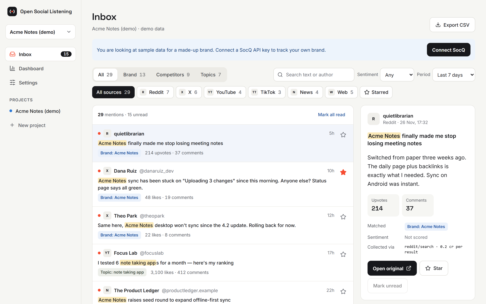
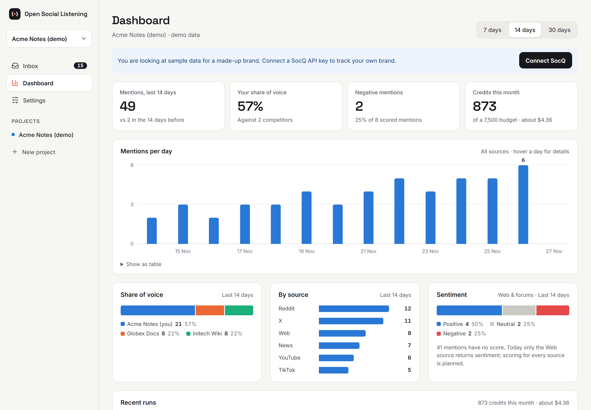
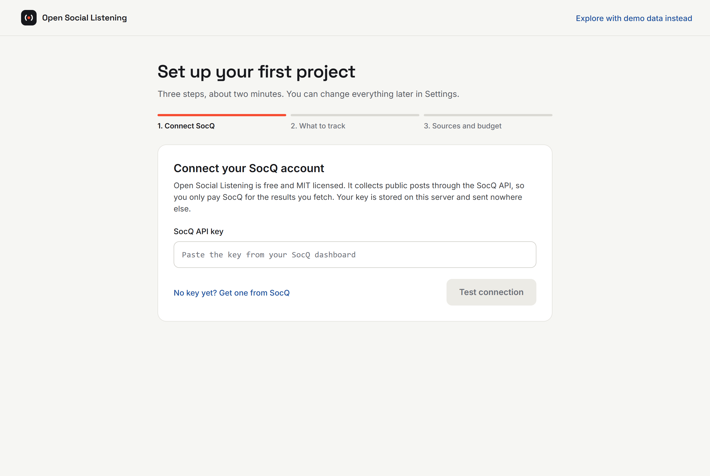

# Open Social Listening

[English](README.md) · **简体中文** · [日本語](README.ja.md) · [Deutsch](README.de.md) · [Bahasa Indonesia](README.id.md)

**开源、可自托管的社交聆听（舆情监测）工具。** 在 Reddit、X、YouTube、TikTok、Instagram、LinkedIn、Threads、新闻网站和公开网页上，追踪你的品牌、竞品和客户讨论的话题，所有结果汇总到一个由你自己运行的收件箱里。

它是 Brand24、Mention、Awario 这类托管工具的开源替代品：MIT 许可证，数据保存在你服务器上的一个 SQLite 文件里，也没有按席位收取的月费。帖子通过
[SocQ API](https://socq.ai/open-social-listening?utm_source=github&utm_medium=readme&utm_campaign=open-social-listening)
采集，按返回的结果计费，一个小品牌每天检查一次，每月只要几美元。

**[在线体验演示](https://socqapi.github.io/open-social-listening/)**：完整的界面，配一个虚构品牌的示例数据，直接在浏览器里运行。无需安装，也不需要 API Key。



## 功能

- **所有平台一个收件箱。** 各个来源的提及汇总到同一个列表，支持未读状态、星标、全文搜索，并可按来源、情感、时间段和命中类型（品牌、竞品或话题）筛选。
- **竞品与声量占比。** 每个竞品单独搜索，仪表盘可以看出谁被讨论得更多、集中在哪些平台。
- **定时运行。** 每个项目可以每 6 小时、每 12 小时、每天或每周运行一次。平台支持时，搜索只回看这个时间窗口；帖子按 URL 去重，同一条帖子不会重复付费。
- **声量突增告警。** 一次运行带来的新提及超过 7 天平均值的设定倍数时，应用会推送到 Slack、Discord、任意 Webhook，或者发送邮件。
- **预算保护。** 每个项目都有月度积分预算。下一次运行会超出预算时，项目自动暂停，不再继续花费。积分用完或 API Key 失效时，项目也会暂停。
- **导出。** 任意筛选结果都能导出为 CSV 或 JSON，也可以通过 JSON API 读取全部数据。
- **五种界面语言。** English、简体中文、日本語、Deutsch 和 Bahasa Indonesia，默认跟随浏览器语言，并记住你的选择。
- **网页和论坛提及带情感分析。** 来自 Web 数据源的提及带有正面、中性或负面评分。社交帖子的情感分析已列入路线图，在此之前显示为 "Not scored"（未评分）。



## 快速开始

需要 Docker，或 Node.js 22 及以上版本。

```bash
git clone https://github.com/SocQAPI/open-social-listening.git
cd open-social-listening
docker compose up -d          # http://localhost:3000, data in ./data
```

打开 http://localhost:3000 。没有 API Key 时，应用会显示和[在线演示](https://socqapi.github.io/open-social-listening/)相同的演示项目，你可以先把每个页面都点一遍。需要真实数据时，在
[SocQ 控制台](https://socq.ai/dashboard/api-key?utm_source=github&utm_medium=readme&utm_campaign=open-social-listening)
创建一个 Key，粘贴到引导流程的第一步，再告诉应用要监测什么。



不想用 Docker 时，`npm install && npm run dev` 会在 3000 端口运行同一个应用。需要长期运行的部署请使用 Docker 镜像：它基于 `output: "standalone"` 构建，已包含静态文件。

如果应用能从公网访问，请设置 `OSL_PASSWORD`，这样每个页面和 API 路由都需要输入密码。

## 数据源与费用

你追踪的每个词，在每次运行时会对每个已启用的数据源各发起一次搜索。SocQ 只对返回的结果计费，保存项目前应用会先给出费用预估。

| 数据源 | SocQ 接口 | 积分 | 默认开启 |
| --- | --- | --- | --- |
| Reddit | `reddit/search` | 每条帖子 0.2 | 是 |
| X | `x/search` | 每条帖子 0.7 | 是 |
| YouTube | `youtube/search` | 每个视频 0.5 | 是 |
| TikTok | `tiktok/search` | 每个视频 0.7 | 是 |
| 新闻 | `seo/google-news` | 每篇文章 0.1 | 是 |
| 网页和论坛 | `brand-monitoring/mentions` | 每次搜索 10 + 每个页面 0.02 | 是 |
| Instagram | `instagram/reels-search` | 每条 Reel 0.5 | 否 |
| LinkedIn | `linkedin/search-posts` | 每条帖子 0.5 | 否 |
| Threads | `threads/search` | 每条帖子 0.6 | 否 |

1 积分 = $0.005。举个例子：一个品牌词、6 个默认数据源、每个来源 20 条结果、每天运行一次，每次最多 54.4 积分，每月约 1,630 积分（约 $8）。讨论较少的词返回的结果更少，费用也更低；预估值是上限。

想控制费用、让结果更相关，就追踪大家实际会写的名称（"Acme Notes"、`@acmenotes`、`acmenotes.com`），不要只用一个常见单词，并为无关的含义添加排除词。排除词不会增加搜索次数，只是在采集后隐藏匹配的帖子。

## 配置

所有配置都是可选的。Docker 部署写在 `.env` 里，`npm run dev` 写在 `.env.local` 里（参见 [.env.example](.env.example)）。

| 变量 | 用途 |
| --- | --- |
| `SOCQ_API_KEY` | SocQ API Key，会覆盖在设置页保存的 Key。 |
| `SOCQ_API_BASE` | SocQ API 的基础地址，默认 `https://api.socq.ai`。 |
| `DATABASE_URL` | libsql 地址，默认 `file:./data/osl.db`（SQLite）。使用远程 libsql/Turso 数据库时另需 `DATABASE_AUTH_TOKEN`。 |
| `OSL_PASSWORD` | 设置后，每个页面和 API 路由都需要用这个密码通过 HTTP Basic 认证。 |
| `SMTP_URL`、`ALERT_FROM` | 邮件告警的 SMTP 连接地址和发件人地址。 |
| `OSL_DISABLE_SCHEDULER` | 设为 `1` 时停用内置的定时任务；"Run now"（立即运行）仍可使用。 |

API Key 保存在你自己的数据库里，只会发送给 SocQ API。

## 工作原理

- **数据源**（`lib/sources/`）：每个 SocQ 搜索接口对应一个文件，负责构造请求（结果数量、时间窗口、排序），并把 SocQ 的标准化记录转换成一条提及。
- **执行器**（`lib/runner.ts`）：对每个已启用的数据源和每个词提交一个 SocQ 任务并轮询，保存新的提及（同一项目内按 URL 去重），记录扣费的积分，并发送突增告警。遇到 401 时项目暂停（`auth`），遇到 402 时暂停（`credits`），运行会超出月度预算时也会暂停（`budget`）。
- **定时任务**（`lib/scheduler.ts`）：由 `instrumentation.ts` 启动，每分钟运行一次到期的项目。
- **告警**（`lib/alerts.ts`）：一次运行的新提及超过某个渠道的倍数乘以最近 7 天的平均值时，向该渠道发送告警（至少需要 3 次历史运行）。
- **费用**（`lib/cost.ts`）：根据 SocQ 的按结果单价，估算每次运行和每月的费用。
- **存储**（`db/`）：基于 libsql/SQLite 的 Drizzle ORM。迁移是 `db/migrations.ts` 里的 SQL，启动时自动执行。

### API

| 路由 | 用途 |
| --- | --- |
| `GET/POST /api/projects` | 列出或创建项目 |
| `GET/PATCH/DELETE /api/projects/:id` | 读取、更新（包括 `paused`）或删除项目 |
| `POST /api/projects/:id/run` | 立即开始一次运行（返回 202，在后台运行） |
| `GET/POST /api/projects/:id/alerts`、`PATCH/DELETE /api/alerts/:id`、`POST /api/alerts/:id/test` | 告警渠道 |
| `GET /api/mentions` | 带筛选和游标分页的提及列表 |
| `PATCH /api/mentions/:id`、`POST /api/mentions/mark-read` | 星标和已读状态 |
| `GET /api/stats` | 每日提及量、声量占比、情感、积分、最近的运行 |
| `GET /api/export` | 下载 CSV 或 JSON |
| `GET/PUT /api/settings`、`GET /api/account` | API Key 和 SocQ 余额 |
| `POST /api/estimate` | 项目草稿的积分预估 |

## 静态演示

`npm run build:demo -- /open-social-listening` 会把只读演示构建到 `out/` 目录，再由
[一个工作流](.github/workflows/pages.yml)发布到 GitHub Pages。它是静态导出：同一套 API 路由处理函数在浏览器里运行，数据来自内存中的 SQLite 数据库（[sql.js](https://sql.js.org)），启动时写入演示项目。因此浏览、筛选、星标和导出都能用；保存设置、调用 SocQ 或发送告警的操作会提示这是只读演示。

## 开发

```bash
npm install
npm run dev          # http://localhost:3000
npm test             # unit and integration tests (vitest)
npm run typecheck
```

技术栈：Next.js 16、React 19、Tailwind CSS 4、基于 libsql 的 Drizzle ORM。CI 会构建 Docker 镜像，并用它逐页检查。

## 路线图

- 为社交帖子提供情感评分，而不只是网页和论坛提及
- SocQ 新增搜索接口后，接入更多数据源

欢迎提交 Issue 和 Pull Request。

## 许可证

[MIT](LICENSE)。由 [SocQ](https://socq.ai/?utm_source=github&utm_medium=readme&utm_campaign=open-social-listening) 团队开发。
