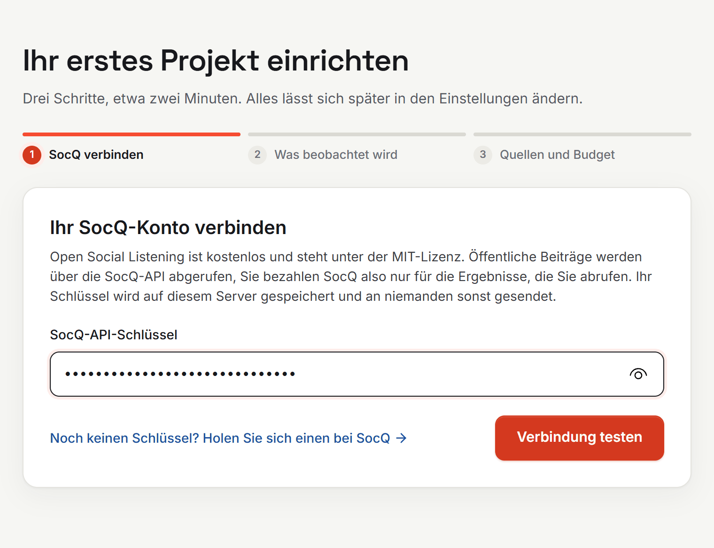
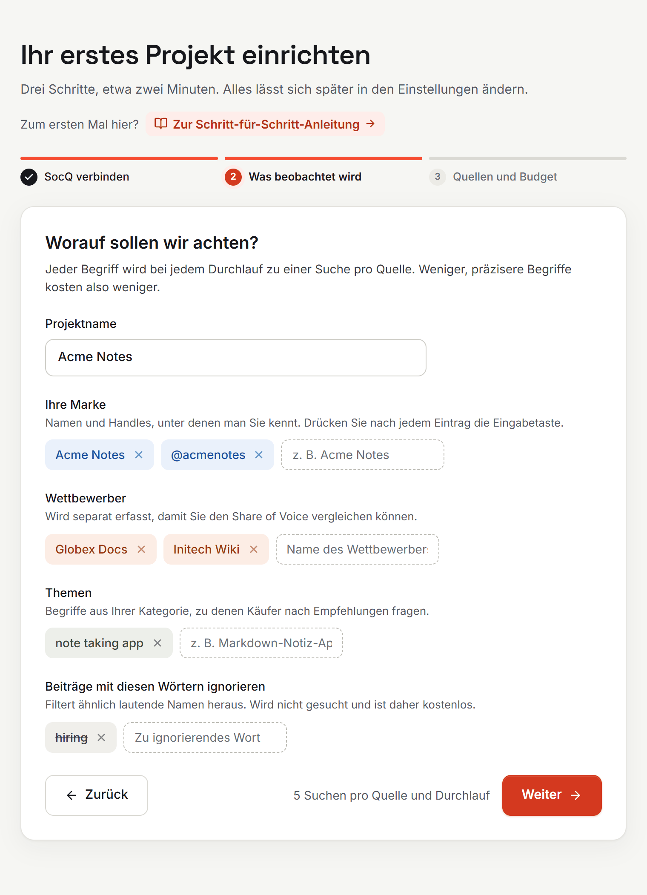
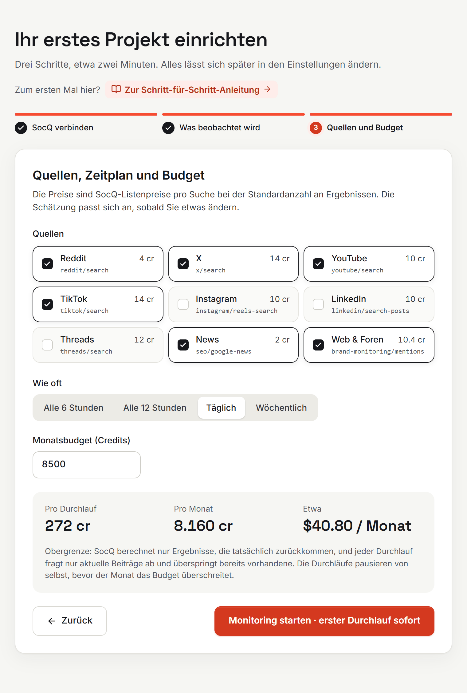
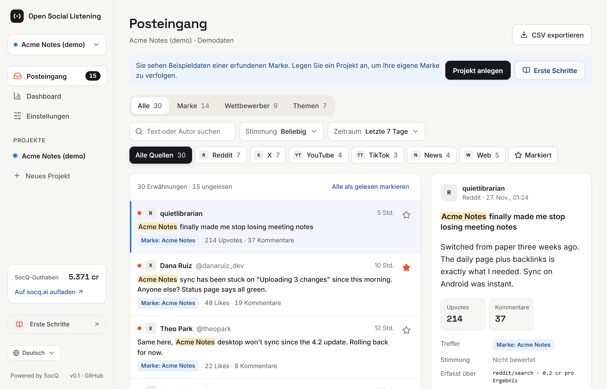
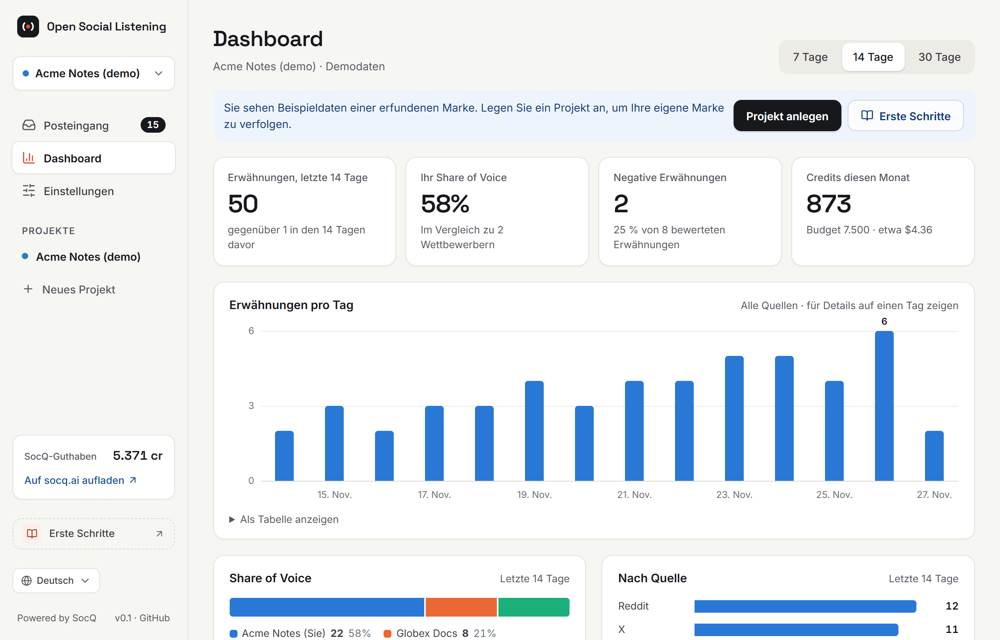
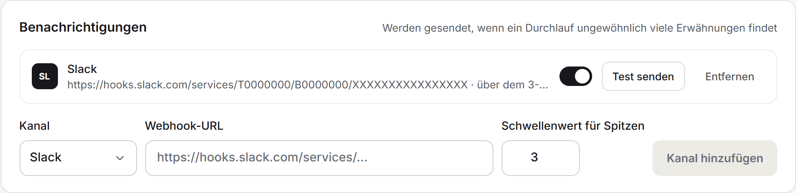

# Erste Schritte

[English](getting-started.md) · [简体中文](getting-started.zh-CN.md) · [日本語](getting-started.ja.md) · **Deutsch** · [Bahasa Indonesia](getting-started.id.md)

Diese Anleitung führt Sie von der frischen Installation zu Ihren ersten Erwähnungen und Ihrer ersten Benachrichtigung
über eine Spitze. Das dauert etwa zehn Minuten. Läuft Open Social Listening noch nicht, beginnen Sie mit der
[Installationsanleitung](deploy.de.md) oder vollziehen Sie die Schritte in der
[Live-Demo](https://socqapi.github.io/open-social-listening/) nach.

## Inhalt

1. [Die Demo erkunden](#1-die-demo-erkunden)
2. [Ihr SocQ-Konto verbinden](#2-ihr-socq-konto-verbinden)
3. [Festlegen, was beobachtet wird](#3-festlegen-was-beobachtet-wird)
4. [Quellen, Zeitplan und Budget wählen](#4-quellen-zeitplan-und-budget-wählen)
5. [Den Posteingang abarbeiten](#5-den-posteingang-abarbeiten)
6. [Das Dashboard lesen](#6-das-dashboard-lesen)
7. [Benachrichtigungen bei Spitzen erhalten](#7-benachrichtigungen-bei-spitzen-erhalten)
8. [Kosten im Griff behalten](#kosten-im-griff-behalten)
9. [Fragen](#fragen)

## 1. Die Demo erkunden

Wenn Sie die App zum ersten Mal öffnen, zeigt sie **Acme Notes (demo)**, eine erfundene Marke mit
Beispielerwähnungen. Klicken Sie sich durch Posteingang, Dashboard und Einstellungen, um zu sehen, was Sie erwartet.
Die Demo kostet nichts und ruft SocQ nie auf.

Die Oberfläche folgt der Sprache Ihres Browsers. Um sie zu ändern, verwenden Sie das Sprachmenü unten in der
Seitenleiste (auf Smartphones oben). Verfügbar sind English, 简体中文, 日本語, Deutsch und Bahasa Indonesia.

Wenn Sie bereit für echte Daten sind, klicken Sie auf die Schaltfläche im blauen Banner: **SocQ verbinden** oder,
falls auf dem Server bereits ein API-Schlüssel hinterlegt ist, **Projekt anlegen**.

## 2. Ihr SocQ-Konto verbinden

Open Social Listening ist kostenlos. Öffentliche Beiträge sammelt die App über die
[SocQ-API](https://socq.ai/?utm_source=github&utm_medium=docs&utm_campaign=open-social-listening), die nur die
Ergebnisse berechnet, die sie tatsächlich liefert.

1. Melden Sie sich auf [socq.ai](https://socq.ai/dashboard/api-key?utm_source=github&utm_medium=docs&utm_campaign=open-social-listening)
   an und erstellen Sie auf der Seite **API-Schlüssel** einen API-Schlüssel.
2. Fügen Sie den Schlüssel in das Feld **SocQ-API-Schlüssel** ein und klicken Sie auf **Verbindung testen**.
3. Die App bestätigt die Verbindung und zeigt Ihr Credit-Guthaben an. Klicken Sie auf **Weiter**.

Der Schlüssel wird in der Datenbank der App auf Ihrem Server gespeichert und ausschließlich an die SocQ-API gesendet.
Wenn Sie auf dem Server `SOCQ_API_KEY` in `.env` setzen, entfällt dieser Schritt.

## 3. Festlegen, was beobachtet wird

Jeder Begriff, den Sie hinzufügen, wird bei jedem Durchlauf zu einer Suche pro Quelle. Wenige präzise Begriffe sind
daher besser als viele vage.

| Feld | Was Sie eintragen | Beispiel |
| --- | --- | --- |
| **Projektname** | Alles, woran Sie das Projekt wiedererkennen. | Acme Notes |
| **Ihre Marke** | Die Namen, Handles und Domains, die Menschen tatsächlich schreiben. | `Acme Notes`, `@acmenotes`, `acmenotes.com` |
| **Wettbewerber** | Bis zu 10. Jeder wird separat gesucht, damit das Dashboard den Share of Voice vergleichen kann. | Globex Docs, Initech Wiki |
| **Themen** | Formulierungen, die Käufer verwenden, wenn sie ein Produkt wie Ihres suchen. | note taking app |
| **Beiträge mit diesen Wörtern ignorieren** | Wörter, an denen man themenfremde Beiträge erkennt. Beiträge, die sie enthalten, werden nicht gespeichert. Sie verursachen keine zusätzlichen Suchen. | hiring, job opening |

Geben Sie einen Begriff ein und drücken Sie die **Eingabetaste** (oder ein Komma), um ihn hinzuzufügen. Mit **×** an
einem Begriff entfernen Sie ihn wieder.

Ist ein Marken- oder Wettbewerbername ein einzelnes Alltagswort wie „Notion“ oder „Linear“, warnt Sie die App: Die
Suche würde auch Beiträge treffen, die das Wort in seiner gewöhnlichen Bedeutung verwenden. Ergänzen Sie den
vollständigen Produktnamen oder das Handle sowie Wörter, die ignoriert werden sollen.

## 4. Quellen, Zeitplan und Budget wählen

**Quellen.** Reddit, X, YouTube, TikTok, News sowie Web & Foren (Blogs, Foren und andere Websites) sind standardmäßig aktiviert.
Instagram, LinkedIn und Threads sind optional. Der Preis neben jeder Quelle ist der SocQ-Listenpreis für eine Suche
mit den standardmäßigen 20 Ergebnissen.

**Wie oft.** Alle 6 Stunden, alle 12 Stunden, täglich oder wöchentlich. Wo die Plattform es unterstützt, blickt jeder
Durchlauf nur so weit zurück wie nötig (auf den letzten Tag, bei wöchentlichen Projekten auf die letzte Woche). Der
erste Durchlauf zeigt daher aktuelle Beiträge statt jahrelanger Historie. Bereits gesammelte Beiträge werden nie ein
zweites Mal berechnet.

**Monatsbudget.** Die App schlägt anhand der Schätzung einen Wert vor. Vor einem Durchlauf, der das Budget
überschreiten würde, pausiert das Projekt, statt mehr auszugeben. Mit 0 gibt es kein Limit.

**Die Schätzung** unten aktualisiert sich, sobald Sie etwas ändern. Sie ist eine Obergrenze: SocQ berechnet nur die
Ergebnisse, die tatsächlich zurückkommen, und ruhige Begriffe liefern weniger. Ein Credit kostet 0,005 $; eine
einzelne Marke auf den sechs Standardquellen, täglich geprüft, kostet höchstens etwa 8 $ im Monat.

Klicken Sie auf **Monitoring starten · erster Durchlauf sofort**. Der erste Durchlauf dauert ein bis drei Minuten;
neue Erwähnungen erscheinen im Posteingang, sobald er abgeschlossen ist.

## 5. Den Posteingang abarbeiten

- **Neue Erwähnungen** tragen einen orangefarbenen Punkt. Wenn Sie eine öffnen, gilt sie als gelesen;
  **Alle als gelesen markieren** erledigt den Rest.
- **Filter** grenzen die Liste nach Art (Marke, Wettbewerber, Themen), Stimmung, Zeitraum und Quelle ein. Die Zahlen an
  den einzelnen Filtern beziehen sich auf den gewählten Zeitraum.
- Die **Suche** findet Wörter im Beitragstext und in Autorennamen.
- **Markieren** Sie Erwähnungen, zu denen Sie zurückkehren möchten, und nutzen Sie dann den Filter **Markiert**.
- **Original öffnen** führt Sie zum Beitrag auf seiner Plattform.
- **CSV exportieren** lädt genau das herunter, was die Filter anzeigen, etwa für eine Tabellenkalkulation oder einen
  Bericht.
- **Jetzt ausführen** (oben rechts) startet sofort einen Durchlauf außerhalb des Zeitplans. Die Beschriftung zeigt,
  was er höchstens kosten kann.

Auf dem Smartphone öffnet sich eine angetippte Erwähnung in einem Fenster, das vom unteren Bildschirmrand
hereingleitet.

## 6. Das Dashboard lesen

- **Die vier Zahlen oben**: Erwähnungen im Zeitraum mit der Veränderung gegenüber dem Zeitraum davor, Ihr Share of
  Voice, negative Erwähnungen und die in diesem Monat verbrauchten Credits.
- **Erwähnungen pro Tag**: Zeigen Sie auf einen Tag, um seine Anzahl und die stärkste Quelle zu sehen. Ein auffällig
  hoher Tag lohnt einen Blick in den Posteingang.
- **Share of Voice**: wie oft Ihre Marke im Vergleich zu den einzelnen Wettbewerbern erwähnt wird.
- **Nach Quelle** und **Stimmung**: wo das Gespräch stattfindet und welche Stimmung es hat. Die Stimmung wird für
  Erwähnungen aus Web und Foren bewertet; Social-Media-Beiträge zeigen vorerst „Nicht bewertet“.
- **Letzte Durchläufe**: wann jeder Durchlauf stattfand, wie viele neue Erwähnungen er gefunden hat und was er
  gekostet hat.

Oben rechts wechseln Sie zwischen 7, 14 und 30 Tagen.

## 7. Benachrichtigungen bei Spitzen erhalten

Öffnen Sie **Einstellungen** und scrollen Sie zu **Benachrichtigungen**. Wählen Sie einen Kanal, fügen Sie das Ziel
ein und klicken Sie auf **Kanal hinzufügen**.

| Kanal | Was Sie einfügen |
| --- | --- |
| **Slack** | Eine Incoming-Webhook-URL. Erstellen Sie in Slack eine App, aktivieren Sie **Incoming Webhooks**, fügen Sie einen Webhook für Ihren Kanal hinzu und kopieren Sie dessen URL. Siehe die [Anleitung von Slack](https://api.slack.com/messaging/webhooks). |
| **Discord** | Eine Webhook-URL: Kanaleinstellungen → **Integrationen** → **Webhooks** → **Neuer Webhook** → **Webhook-URL kopieren**. |
| **Webhook** | Eine beliebige URL, die einen JSON-`POST` annimmt, etwa für Zapier, Make, n8n oder Ihren eigenen Code. |
| **E-Mail** | Eine Adresse. Der Server benötigt `SMTP_URL` und `ALERT_FROM` in `.env` (siehe die [Installationsanleitung](deploy.de.md#3-open-social-listening-starten)). |

Der **Schwellenwert für Spitzen** legt fest, was als Spitze gilt. Bei 3 löst ein Durchlauf eine Benachrichtigung aus,
wenn er mehr als das Dreifache der durchschnittlichen neuen Erwähnungen pro Durchlauf der letzten 7 Tage findet. Die
App braucht mindestens drei frühere Durchläufe, bevor sie das beurteilen kann; die ersten Benachrichtigungen kommen
daher erst nach einigen Tagen. Mit **Test senden** prüfen Sie einen Kanal sofort.

## Kosten im Griff behalten

- **Budget.** Jedes Projekt hat ein monatliches Credit-Budget. Die Seitenleiste zeigt, wie viel davon verbraucht ist.
  Würde der nächste Durchlauf es überschreiten, pausiert das Projekt und weist oben auf jeder Seite darauf hin;
  erhöhen Sie das Budget in den **Einstellungen** und klicken Sie auf **Fortsetzen**.
- **Credits aufgebraucht oder Schlüssel abgelehnt.** Auch dann pausiert das Projekt. Laden Sie auf socq.ai Guthaben
  auf oder ersetzen Sie den Schlüssel unter **Einstellungen → SocQ-Verbindung** und setzen Sie das Projekt dann fort.
- **Weniger, präzisere Begriffe** kosten weniger als viele breite, und weniger Ergebnisse pro Suche kosten weniger als
  die standardmäßigen 20. Beides ändern Sie in den **Einstellungen**; die Monatsschätzung aktualisiert sich, während
  Sie bearbeiten.
- **Pausieren** hält ein Projekt jederzeit an, ohne dass etwas verloren geht. Änderungen in den Einstellungen gelten
  ab dem nächsten Durchlauf.

## Fragen

**Der Posteingang ist nach dem ersten Durchlauf leer.** Ruhige Begriffe finden am letzten Tag womöglich nichts. Warten
Sie einige Durchläufe ab, ergänzen Sie die Schreibweisen, die Menschen wirklich verwenden, oder stellen Sie den Filter
**Zeitraum** auf „Letzte 30 Tage“. **Letzte Durchläufe** im Dashboard zeigt, ob die Durchläufe erfolgreich sind.

**Warum sind manche Beiträge themenfremd?** Der Begriff bedeutet auch etwas anderes. Tragen Sie Wörter, die in diesen
Beiträgen vorkommen, in den Einstellungen unter **Beiträge mit diesen Wörtern ignorieren** ein. Ab dem nächsten
Durchlauf werden Beiträge mit diesen Wörtern nicht mehr gespeichert; Erwähnungen, die schon im Posteingang sind,
bleiben erhalten.

**Kann ich mehr als eine Marke verfolgen?** Ja. Legen Sie mit **Neues Projekt** in der Seitenleiste ein Projekt pro
Marke an und wechseln Sie über das Menü oben in der Seitenleiste zwischen ihnen.

**Wo liegen meine Daten?** In der SQLite-Datenbank auf Ihrem Server. Außer den Suchanfragen an SocQ wird nichts
irgendwohin gesendet. Wie Sie die Daten sichern, zeigt die
[Installationsanleitung](deploy.de.md#7-daten-sichern-und-umziehen).

**Kann ich die Daten exportieren?** Mit **CSV exportieren** im Posteingang oder als JSON über die API
(`GET /api/export?projectId=1&format=json`). Das [README](../README.de.md#api) listet alle Routen auf.
