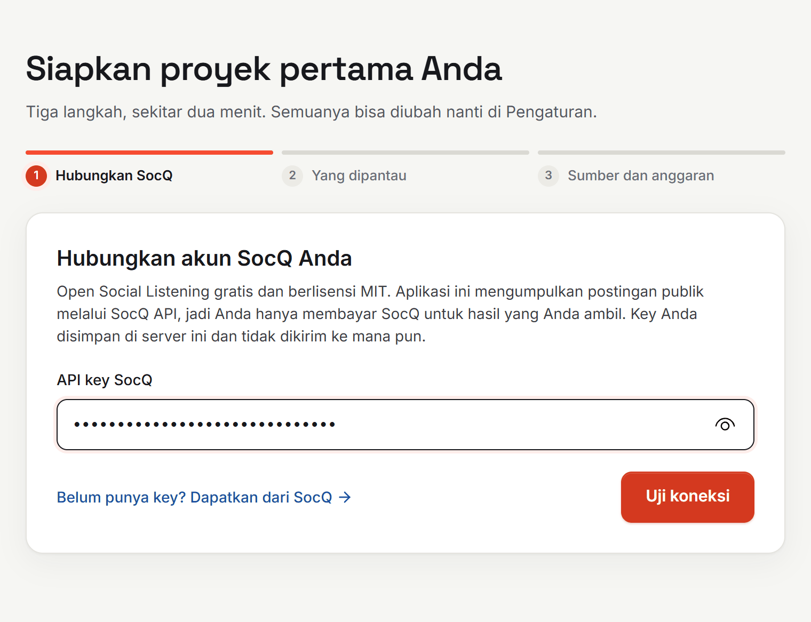
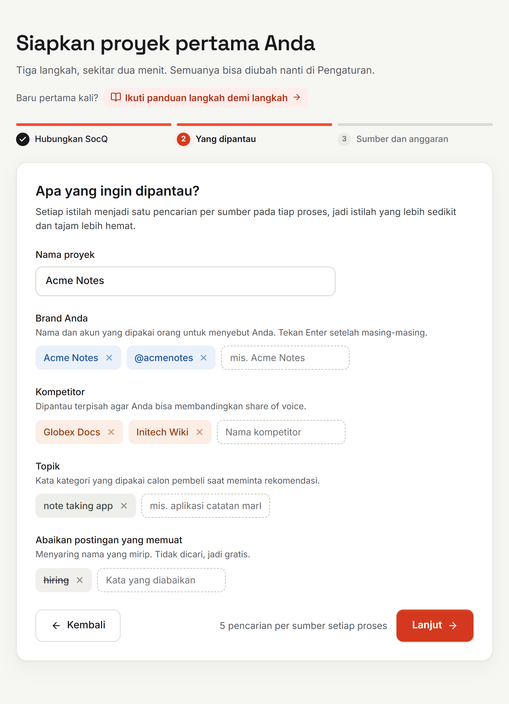
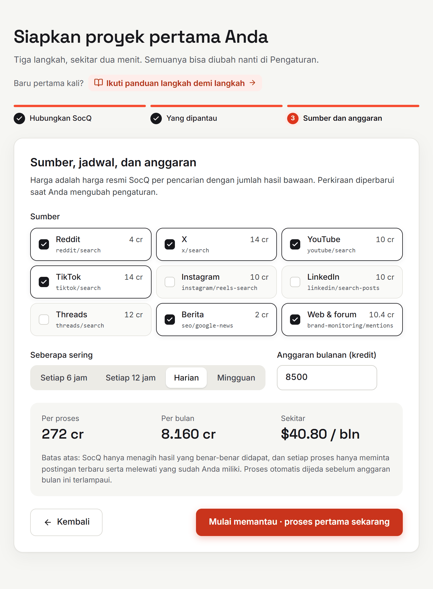
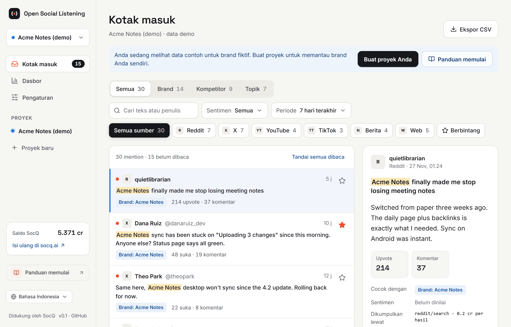
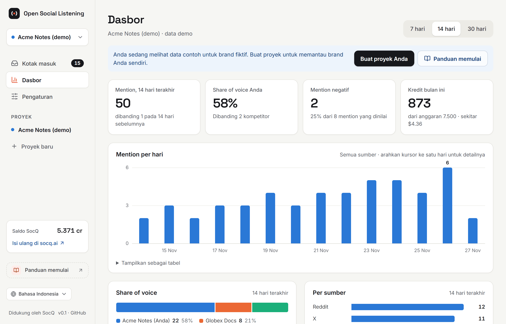
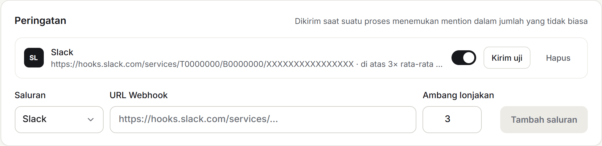

# Memulai

[English](getting-started.md) · [简体中文](getting-started.zh-CN.md) · [日本語](getting-started.ja.md) · [Deutsch](getting-started.de.md) · **Bahasa Indonesia**

Panduan ini memandu Anda dari instalasi baru hingga mention pertama dan peringatan lonjakan pertama Anda. Waktunya
sekitar sepuluh menit. Jika Open Social Listening belum berjalan, mulailah dari [panduan deployment](deploy.id.md),
atau ikuti langkah-langkahnya di [demo langsung](https://socqapi.github.io/open-social-listening/).

## Daftar isi

1. [Jelajahi demo](#1-jelajahi-demo)
2. [Hubungkan akun SocQ Anda](#2-hubungkan-akun-socq-anda)
3. [Tentukan apa yang dipantau](#3-tentukan-apa-yang-dipantau)
4. [Pilih sumber, jadwal, dan anggaran](#4-pilih-sumber-jadwal-dan-anggaran)
5. [Kelola kotak masuk](#5-kelola-kotak-masuk)
6. [Pahami dasbor](#6-pahami-dasbor)
7. [Dapatkan peringatan saat mention melonjak](#7-dapatkan-peringatan-saat-mention-melonjak)
8. [Kendalikan biaya](#kendalikan-biaya)
9. [Pertanyaan](#pertanyaan)

## 1. Jelajahi demo

Saat pertama kali dibuka, aplikasi menampilkan **Acme Notes (demo)**, brand fiktif dengan contoh mention. Telusuri
kotak masuk, dasbor, dan pengaturan untuk melihat apa yang akan Anda dapatkan. Demo ini tidak memakan biaya dan tidak
pernah memanggil SocQ.

Bahasa antarmuka mengikuti bahasa browser Anda. Untuk mengubahnya, gunakan menu bahasa di bagian bawah sidebar (di
bagian atas pada ponsel). Tersedia English, 简体中文, 日本語, Deutsch, dan Bahasa Indonesia.

Saat Anda siap memakai data sungguhan, klik tombol di banner biru: **Hubungkan SocQ**, atau **Buat proyek Anda** jika
server sudah punya API key.

## 2. Hubungkan akun SocQ Anda

Open Social Listening gratis. Aplikasi ini mengumpulkan postingan publik melalui [SocQ API](https://socq.ai/?utm_source=github&utm_medium=docs&utm_campaign=open-social-listening),
yang hanya menagih hasil yang dikembalikannya.

1. Masuk di [socq.ai](https://socq.ai/dashboard/api-key?utm_source=github&utm_medium=docs&utm_campaign=open-social-listening)
   lalu buat key di halaman **Kunci API**.
2. Tempel key tersebut ke kolom **API key SocQ**, lalu klik **Uji koneksi**.
3. Aplikasi mengonfirmasi koneksi dan menampilkan saldo kredit Anda. Klik **Lanjut**.

Key disimpan di database aplikasi di server Anda dan hanya pernah dikirim ke SocQ API. Jika Anda mengatur
`SOCQ_API_KEY` di `.env` di server, langkah ini dilewati.

## 3. Tentukan apa yang dipantau

Setiap istilah yang Anda tambahkan menjadi satu pencarian per sumber pada setiap proses, jadi beberapa istilah yang
tepat lebih baik daripada banyak istilah yang samar.

| Kolom | Yang diisi | Contoh |
| --- | --- | --- |
| **Nama proyek** | Apa saja yang membantu Anda mengenalinya. | Acme Notes |
| **Brand Anda** | Nama, handle, dan domain yang benar-benar ditulis orang. | `Acme Notes`, `@acmenotes`, `acmenotes.com` |
| **Kompetitor** | Maksimal 10. Masing-masing dicari terpisah, sehingga dasbor bisa membandingkan share of voice. | Globex Docs, Initech Wiki |
| **Topik** | Frasa yang dipakai calon pembeli saat mencari produk seperti milik Anda. | note taking app |
| **Abaikan postingan yang memuat** | Kata-kata yang menandai postingan yang tidak terkait. Postingan yang memuatnya tidak disimpan. Kata-kata ini tidak menambah pencarian. | hiring, job opening |

Ketik sebuah istilah lalu tekan **Enter** (atau koma) untuk menambahkannya. Klik **×** pada istilah untuk
menghapusnya.

Jika nama brand atau kompetitor hanya berupa satu kata sehari-hari, seperti "Notion" atau "Linear", aplikasi akan
memperingatkan Anda: pencariannya juga akan cocok dengan postingan yang memakai kata itu dalam arti biasanya.
Tambahkan nama produk lengkap atau handle-nya, serta kata-kata yang diabaikan.

## 4. Pilih sumber, jadwal, dan anggaran

**Sumber.** Reddit, X, YouTube, TikTok, berita, dan web (blog dan forum) aktif secara default. Instagram, LinkedIn,
dan Threads bersifat opsional. Harga di samping masing-masing adalah harga resmi SocQ untuk satu pencarian dengan
20 hasil bawaan.

**Seberapa sering.** Setiap 6 jam, setiap 12 jam, harian, atau mingguan. Jika platform mendukungnya, setiap proses
hanya melihat ke belakang sejauh yang diperlukan (satu hari terakhir, atau satu minggu terakhir untuk proyek
mingguan), sehingga proses pertama menampilkan postingan terbaru, bukan riwayat bertahun-tahun. Postingan yang sudah
dikumpulkan tidak pernah ditagih lagi.

**Anggaran bulanan.** Aplikasi menyarankan angkanya berdasarkan perkiraan. Sebelum menjalankan proses yang akan
melampaui anggaran, proyek dijeda alih-alih terus membelanjakan kredit. Isi 0 jika tidak ingin ada batas.

**Perkiraan** di bagian bawah diperbarui setiap kali Anda mengubah sesuatu. Angka ini adalah batas atas: SocQ hanya
menagih hasil yang benar-benar dikembalikan, dan istilah yang jarang dibicarakan menghasilkan lebih sedikit. Satu
kredit setara dengan $0,005; satu brand di enam sumber default yang dicek setiap hari paling banyak menghabiskan
sekitar $8 per bulan.

Klik **Mulai memantau · proses pertama sekarang**. Proses pertama memakan waktu satu hingga tiga menit; mention baru
muncul di kotak masuk begitu proses selesai.

## 5. Kelola kotak masuk

- **Mention baru** ditandai titik oranye. Membuka sebuah mention akan menandainya sudah dibaca; **Tandai semua
  dibaca** menandai sisanya.
- **Filter** mempersempit daftar berdasarkan jenis (brand, kompetitor, topik), sentimen, periode, dan sumber. Angka
  pada setiap filter adalah jumlah untuk periode yang dipilih.
- Kolom **Cari teks atau penulis** menemukan kata di teks postingan dan di nama penulis.
- **Beri bintang** pada mention yang ingin Anda buka lagi nanti, lalu gunakan filter **Berbintang**.
- **Buka postingan asli** membawa Anda ke postingan tersebut di platform asalnya.
- **Ekspor CSV** mengunduh persis apa yang ditampilkan filter, untuk spreadsheet atau laporan.
- **Jalankan sekarang** (kanan atas) langsung memulai proses di luar jadwal. Labelnya menunjukkan biaya maksimalnya.

Di ponsel, mengetuk sebuah mention akan membukanya di panel yang muncul dari bagian bawah layar.

## 6. Pahami dasbor

- **Empat angka di bagian atas**: mention dalam periode ini beserta perubahannya dibanding periode sebelumnya, share
  of voice Anda, mention negatif, dan kredit yang terpakai bulan ini.
- **Mention per hari**: arahkan kursor ke satu hari untuk melihat jumlahnya dan sumber tersibuknya. Hari yang
  batangnya tinggi layak dicek di kotak masuk.
- **Share of voice**: seberapa sering brand Anda disebut dibandingkan dengan masing-masing kompetitor.
- **Per sumber** dan **Sentimen**: di mana percakapan berlangsung dan bagaimana nadanya. Sentimen dinilai untuk
  mention dari web dan forum; untuk sementara postingan media sosial menampilkan "Belum dinilai".
- **Proses terbaru**: kapan setiap proses berjalan, berapa mention baru yang ditemukannya, dan berapa biayanya.

Beralih antara 7, 14, dan 30 hari di kanan atas.

## 7. Dapatkan peringatan saat mention melonjak

Buka **Pengaturan** lalu gulir ke **Peringatan**. Pilih saluran, tempel alamat tujuannya, lalu klik **Tambah saluran**.

| Saluran | Yang ditempel |
| --- | --- |
| **Slack** | URL incoming webhook. Di Slack, buat app, aktifkan **Incoming Webhooks**, tambahkan satu webhook untuk channel Anda, lalu salin URL-nya. Lihat [panduan Slack](https://api.slack.com/messaging/webhooks). |
| **Discord** | URL webhook: pengaturan channel → **Integrations** → **Webhooks** → **New Webhook** → **Copy Webhook URL**. |
| **Webhook** | URL apa pun yang menerima `POST` JSON, untuk Zapier, Make, n8n, atau kode Anda sendiri. |
| **Email** | Sebuah alamat email. Server memerlukan `SMTP_URL` dan `ALERT_FROM` di `.env` (lihat [panduan deployment](deploy.id.md#3-jalankan-open-social-listening)). |

**Ambang lonjakan** menentukan apa yang dianggap sebagai lonjakan. Dengan nilai 3, sebuah proses mengirim peringatan
jika menemukan lebih dari tiga kali rata-rata mention baru per proses selama 7 hari terakhir. Aplikasi memerlukan
setidaknya tiga proses sebelumnya sebelum bisa menilai, jadi peringatan pertama baru datang setelah beberapa hari.
Gunakan **Kirim uji** untuk langsung mengecek sebuah saluran.

## Kendalikan biaya

- **Anggaran.** Setiap proyek punya anggaran kredit bulanan. Sidebar menunjukkan berapa banyak yang sudah terpakai.
  Jika proses berikutnya akan melampauinya, proyek dijeda dan menampilkan pemberitahuan di bagian atas setiap
  halaman; naikkan anggaran di **Pengaturan**, lalu klik **Lanjutkan**.
- **Kredit habis atau key ditolak.** Proyek juga akan dijeda. Isi ulang di socq.ai, atau ganti key di
  **Pengaturan → Koneksi SocQ**, lalu lanjutkan.
- **Istilah yang lebih sedikit dan tajam** lebih hemat daripada banyak istilah yang luas, dan hasil per pencarian
  yang lebih sedikit lebih hemat daripada 20 hasil bawaan. Ubah keduanya di **Pengaturan**; perkiraan bulanan
  diperbarui saat Anda mengedit.
- **Jeda** menghentikan proyek kapan saja tanpa kehilangan apa pun. Perubahan di Pengaturan berlaku mulai proses
  berikutnya.

## Pertanyaan

**Kotak masuk kosong setelah proses pertama.** Istilah yang jarang dibicarakan bisa saja tidak menemukan apa pun
dalam satu hari terakhir. Tunggu beberapa proses, tambahkan ejaan yang benar-benar dipakai orang, atau ubah filter
periode ke 30 hari terakhir. **Proses terbaru** di dasbor menunjukkan apakah proses berhasil.

**Mengapa ada postingan yang tidak terkait?** Istilah tersebut juga punya arti lain. Tambahkan kata-kata yang muncul
di postingan itu ke **Abaikan postingan yang memuat** di Pengaturan. Mulai proses berikutnya, postingan yang
memuatnya tidak disimpan; mention yang sudah ada di kotak masuk tetap ada.

**Bisakah saya memantau lebih dari satu brand?** Bisa. Buat satu proyek per brand dengan **Proyek baru** di sidebar,
lalu beralih di antara proyek lewat menu di bagian atas sidebar.

**Di mana data saya disimpan?** Di database SQLite di server Anda. Tidak ada yang dikirim ke mana pun selain
pencarian ke SocQ. [Panduan deployment](deploy.id.md#7-backup-dan-pindahkan-data-anda) menjelaskan cara
mem-backup-nya.

**Bisakah saya mengekspor data?** Gunakan **Ekspor CSV** di kotak masuk, atau ambil JSON dari API
(`GET /api/export?projectId=1&format=json`). [README](../README.id.md#api) mencantumkan semua route.
