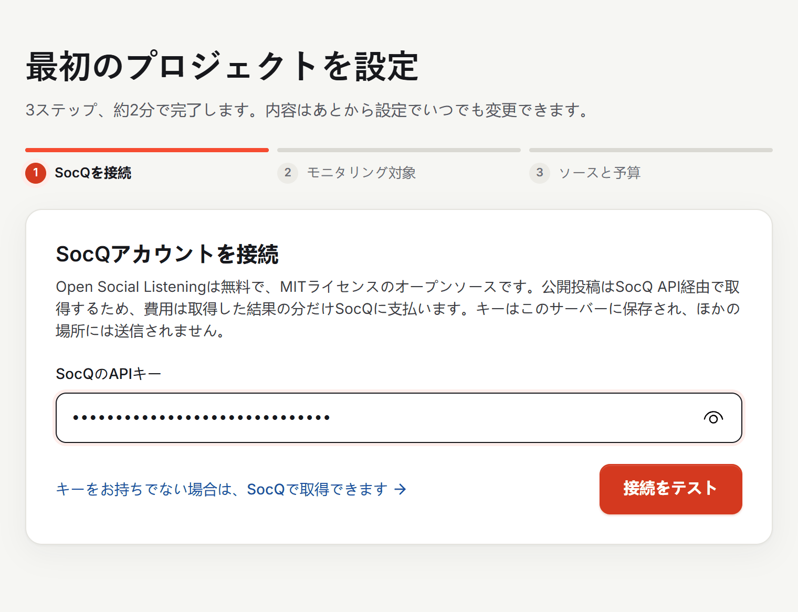
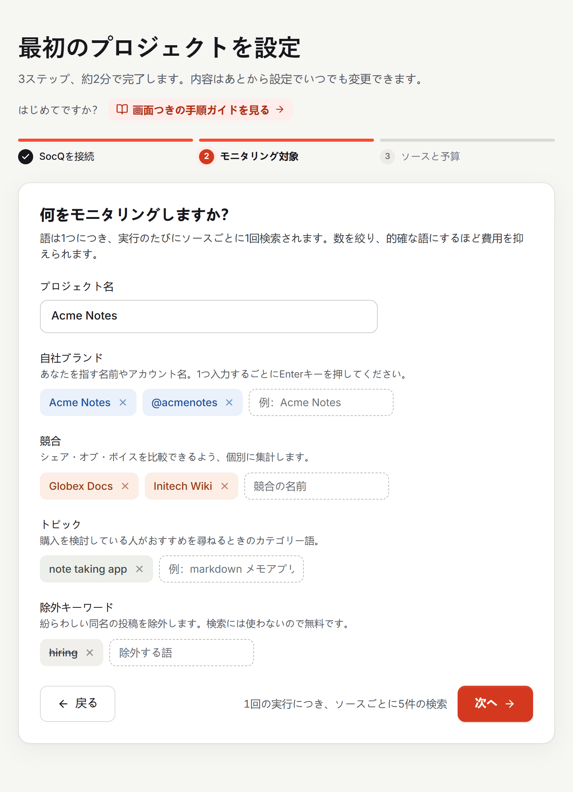
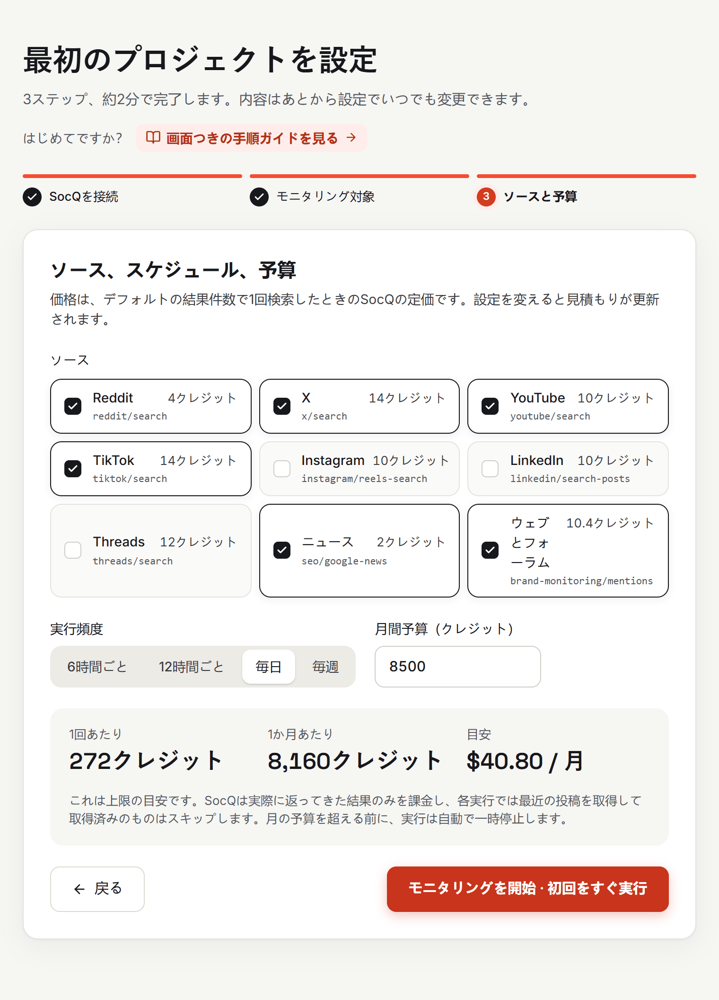
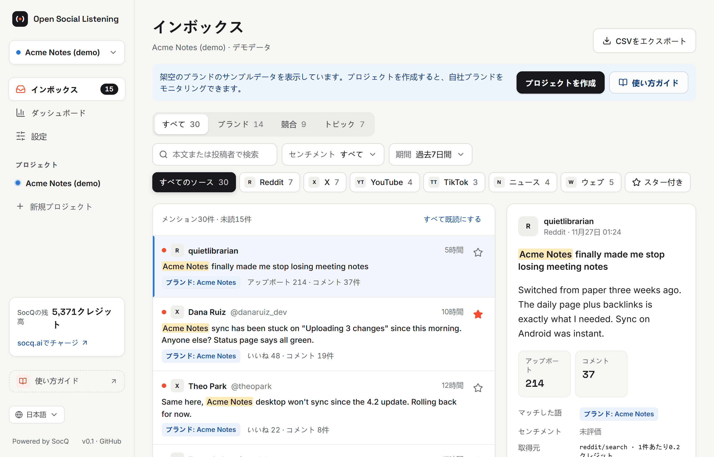
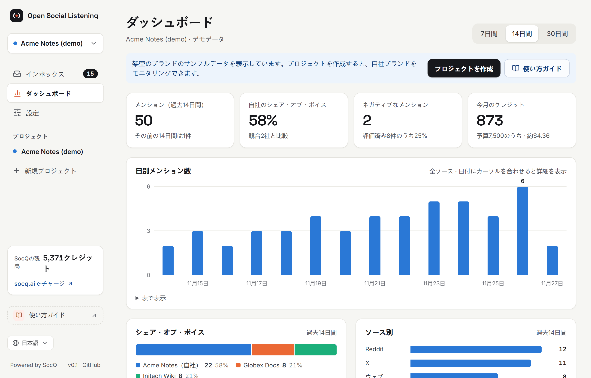
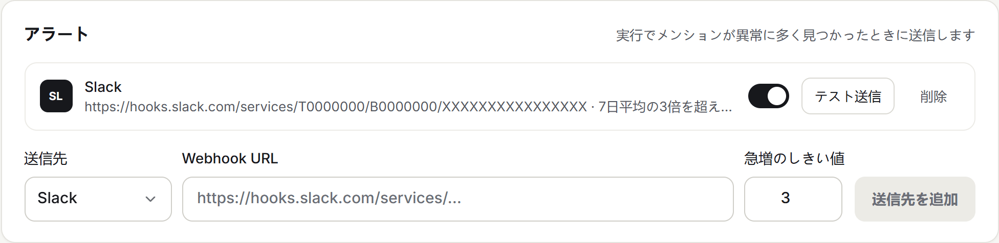

# はじめに

[English](getting-started.md) · [简体中文](getting-started.zh-CN.md) · **日本語** · [Deutsch](getting-started.de.md) · [Bahasa Indonesia](getting-started.id.md)

このガイドでは、インストールしたばかりの状態から、最初のメンションを取得し、最初の急増アラートを受け取るまでを順に説明します。所要時間は10分ほどです。Open Social Listeningがまだ動いていない場合は、[デプロイガイド](deploy.ja.md)から始めるか、[ライブデモ](https://socqapi.github.io/open-social-listening/)で操作しながら読み進めてください。

## 目次

1. [デモを見てみる](#1-デモを見てみる)
2. [SocQアカウントを接続する](#2-socqアカウントを接続する)
3. [モニタリング対象を決める](#3-モニタリング対象を決める)
4. [ソース、スケジュール、予算を選ぶ](#4-ソーススケジュール予算を選ぶ)
5. [インボックスを確認する](#5-インボックスを確認する)
6. [ダッシュボードの見方](#6-ダッシュボードの見方)
7. [メンションの急増をアラートで知る](#7-メンションの急増をアラートで知る)
8. [費用を抑える](#費用を抑える)
9. [よくある質問](#よくある質問)

## 1. デモを見てみる

アプリを初めて開くと、サンプルのメンションが入った架空のブランド「**Acme Notes (demo)**」が表示されます。インボックス、ダッシュボード、設定を順に開いて、どのような画面になるのかを確かめてみてください。デモは無料で、SocQを呼び出すこともありません。

画面の表示言語はブラウザの言語に合わせて決まります。変更するには、サイドバー下部（スマートフォンでは画面上部）の言語メニューを使います。English、简体中文、日本語、Deutsch、Bahasa Indonesiaから選べます。

実際のデータを使う準備ができたら、青いバナーにあるボタンをクリックします。ボタンは**SocQを接続**ですが、サーバーにAPIキーがすでに設定されている場合は**プロジェクトを作成**になります。

## 2. SocQアカウントを接続する

Open Social Listeningは無料です。公開投稿は[SocQ API](https://socq.ai/?utm_source=github&utm_medium=docs&utm_campaign=open-social-listening)経由で収集し、SocQ APIは返された結果の分だけ課金します。

1. [socq.ai](https://socq.ai/dashboard/api-key?utm_source=github&utm_medium=docs&utm_campaign=open-social-listening)にサインインし、**APIキー**ページでAPIキーを作成します。
2. キーを**SocQのAPIキー**欄に貼り付け、**接続をテスト**をクリックします。
3. 接続が確認されると、クレジット残高が表示されます。**次へ**をクリックします。

キーはサーバー上のアプリのデータベースに保存され、SocQ API以外に送信されることはありません。サーバーの`.env`で`SOCQ_API_KEY`を設定している場合、この手順はスキップされます。

## 3. モニタリング対象を決める

追加した語は1つにつき、実行のたびにソースごとに1回検索されます。そのため、あいまいな語をたくさん入れるより、的確な語を少数に絞るほうが効果的です。

| 項目 | 入力する内容 | 例 |
| --- | --- | --- |
| **プロジェクト名** | 自分で見分けやすい名前なら何でもかまいません。 | Acme Notes |
| **自社ブランド** | 実際に書き込まれている名前、アカウント名、ドメイン。 | `Acme Notes`、`@acmenotes`、`acmenotes.com` |
| **競合** | 最大10件。それぞれ個別に検索されるため、ダッシュボードでシェア・オブ・ボイスを比較できます。 | Globex Docs、Initech Wiki |
| **トピック** | あなたの製品のようなものを探している人が使うフレーズ。 | note taking app |
| **除外キーワード** | 無関係な投稿の目印になる語。これを含む投稿は保存されません。検索回数は増えません。 | hiring, job opening |

語を入力して**Enter**キー（またはカンマ）を押すと追加されます。語の「**×**」をクリックすると削除されます。

ブランド名や競合名が「Notion」や「Linear」のように日常的な単語1つだけの場合は、アプリが警告を表示します。その単語を本来の意味で使っている投稿にも、検索がマッチしてしまうためです。製品の正式名称やアカウント名と、除外する語を追加してください。

## 4. ソース、スケジュール、予算を選ぶ

**ソース**。Reddit、X、YouTube、TikTok、ニュース、ウェブ（ブログとフォーラム）はデフォルトでオンになっています。Instagram、LinkedIn、Threadsは必要に応じてオンにします。各ソースの横に表示される価格は、デフォルトの20件で1回検索したときのSocQの定価です。

**実行頻度**。6時間ごと、12時間ごと、毎日、毎週から選びます。プラットフォームが対応していれば、各実行は必要な範囲（直近1日、毎週のプロジェクトでは直近1週間）だけさかのぼって検索します。そのため初回の実行でも、何年も前の投稿ではなく最近の投稿が表示されます。すでに取得した投稿に再び課金されることはありません。

**月間予算（クレジット）**。アプリが見積もりをもとに予算を提案します。予算を超えそうな実行の前に、プロジェクトはそれ以上消費せずに一時停止します。上限を設けない場合は0を設定します。

画面下部の**見積もり**は、設定を変えるたびに更新されます。これは上限の目安です。SocQは実際に返ってきた結果の分だけ課金し、話題の少ない語ほど返ってくる結果も少なくなります。1クレジットは$0.005です。デフォルトの6つのソースで1つのブランドを毎日チェックする場合、費用は高くても月に約$8です。

**モニタリングを開始 · 初回をすぐ実行**をクリックします。初回の実行には1〜3分かかります。実行が終わるとすぐに、新しいメンションがインボックスに表示されます。

## 5. インボックスを確認する

- **新しいメンション**にはオレンジ色の点が付きます。開くと既読になり、**すべて既読にする**で残りもまとめて既読にできます。
- **フィルター**では、種類（ブランド、競合、トピック）、センチメント、期間、ソースで一覧を絞り込めます。各フィルターに表示される数は、選択した期間内の件数です。
- 検索欄（**本文または投稿者で検索**）では、投稿の本文と投稿者名に含まれる語を検索できます。
- あとで見返したいメンションには**スター**を付けておき、**スター付き**フィルターで絞り込みます。
- **元の投稿を開く**をクリックすると、そのプラットフォーム上の投稿に移動します。
- **CSVをエクスポート**では、フィルターで表示されている内容をそのままダウンロードできます。スプレッドシートやレポートに使えます。
- 右上の**今すぐ実行**をクリックすると、スケジュールとは別にすぐ実行が始まります。ボタンのラベルには、かかる費用の上限が表示されます。

スマートフォンでは、メンションをタップすると画面下部からパネルが開き、内容が表示されます。

## 6. ダッシュボードの見方

- **上部の4つの数値**：期間内のメンション数（その前の期間との比較付き）、自社のシェア・オブ・ボイス、ネガティブなメンション、今月の使用クレジットです。
- **日別メンション数**：日付にカーソルを合わせると、その日の件数と最も多かったソースが表示されます。件数が突出している日は、インボックスで確認する価値があります。
- **シェア・オブ・ボイス**：自社ブランドが各競合と比べてどれだけ言及されているかを示します。
- **ソース別**と**センチメント**：どこで話題になっているか、どのような論調かを示します。センチメントはウェブとフォーラムのメンションに対して評価され、SNSの投稿は現時点では「未評価」と表示されます。
- **最近の実行**：各実行の日時、見つかった新しいメンションの数、かかった費用を示します。

右上で7日間、14日間、30日間を切り替えられます。

## 7. メンションの急増をアラートで知る

**設定**を開き、**アラート**までスクロールします。送信先の種類を選んで宛先を貼り付け、**送信先を追加**をクリックします。

| 送信先 | 貼り付ける内容 |
| --- | --- |
| **Slack** | Incoming WebhookのURL。Slackでアプリを作成して**Incoming Webhooks**をオンにし、通知先のチャンネル用にWebhookを追加して、そのURLをコピーします。詳しくは[Slackのガイド](https://api.slack.com/messaging/webhooks)を参照してください。 |
| **Discord** | WebhookのURL。チャンネルの設定 → **Integrations** → **Webhooks** → **New Webhook** → **Copy Webhook URL**の順に操作します。 |
| **Webhook** | JSONの`POST`を受け付ける任意のURL。Zapier、Make、n8n、自作のコードなどで使えます。 |
| **メール** | メールアドレス。サーバーの`.env`に`SMTP_URL`と`ALERT_FROM`を設定しておく必要があります（[デプロイガイド](deploy.ja.md#3-open-social-listeningを起動する)を参照）。 |

**急増のしきい値**で、何を急増とみなすかを決めます。3に設定すると、1回の実行で見つかった新しいメンションが、直近7日間の1回あたりの平均の3倍を超えたときにアラートが送られます。判定には少なくとも過去3回分の実行が必要なため、最初のアラートが届くのは数日後になります。**テスト送信**を使うと、送信先をすぐに確認できます。

## 費用を抑える

- **予算**。各プロジェクトには月間のクレジット予算があり、その使用量はサイドバーに表示されます。次の実行で予算を超えそうになると、プロジェクトは一時停止し、すべてのページの上部にその旨が表示されます。**設定**で予算を増やし、**再開**をクリックしてください。
- **クレジット切れ、またはキーの拒否**。この場合もプロジェクトは一時停止します。socq.aiでチャージするか、**設定 → SocQとの接続**でキーを差し替えてから再開してください。
- **語を少なく、的確に**するほうが、範囲の広い語をたくさん使うより費用を抑えられます。また、検索あたりの結果数をデフォルトの20件より減らしても費用は下がります。どちらも**設定**で変更でき、編集に合わせて月間の見積もりが更新されます。
- **一時停止**を使えば、何も失うことなく、いつでもプロジェクトを止められます。設定の変更は次回の実行から反映されます。

## よくある質問

**初回の実行後もインボックスが空です**。話題の少ない語では、直近1日に何も見つからないことがあります。何回か実行されるのを待つか、実際に使われている表記を追加するか、期間フィルターを「過去30日間」に切り替えてください。実行が成功しているかどうかは、ダッシュボードの**最近の実行**で確認できます。

**関係のない投稿が含まれるのはなぜですか**？その語に別の意味もあるためです。そうした投稿に含まれる語を、設定の**除外キーワード**に追加してください。次回の実行以降、それらの語を含む投稿は保存されなくなります。すでにインボックスにあるメンションはそのまま残ります。

**複数のブランドを追跡できますか**？はい。サイドバーの**新規プロジェクト**から、ブランドごとにプロジェクトを1つずつ作成してください。プロジェクトの切り替えは、サイドバー上部のメニューで行います。

**データはどこにありますか**？ご自身のサーバー上のSQLiteデータベースです。SocQへの検索を除き、データがどこかへ送信されることはありません。バックアップの方法は[デプロイガイド](deploy.ja.md#7-データのバックアップと移行)で説明しています。

**データを書き出せますか**？インボックスの**CSVをエクスポート**を使うか、APIからJSONで取得できます（`GET /api/export?projectId=1&format=json`）。すべてのルートの一覧は[README](../README.ja.md#api)にあります。
