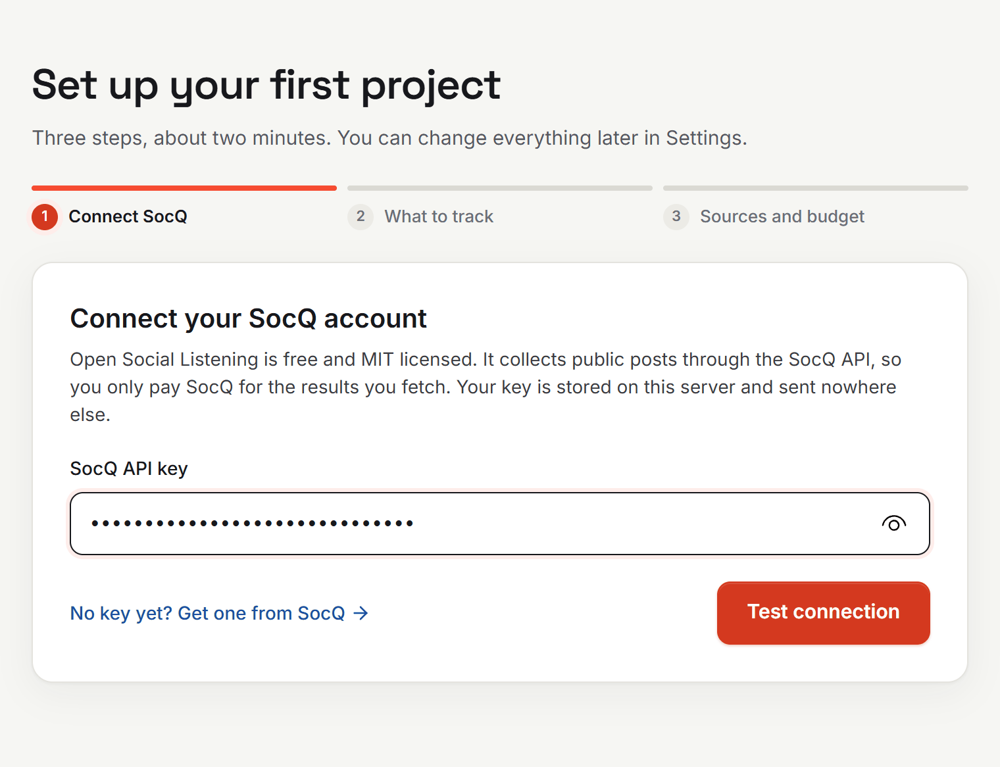
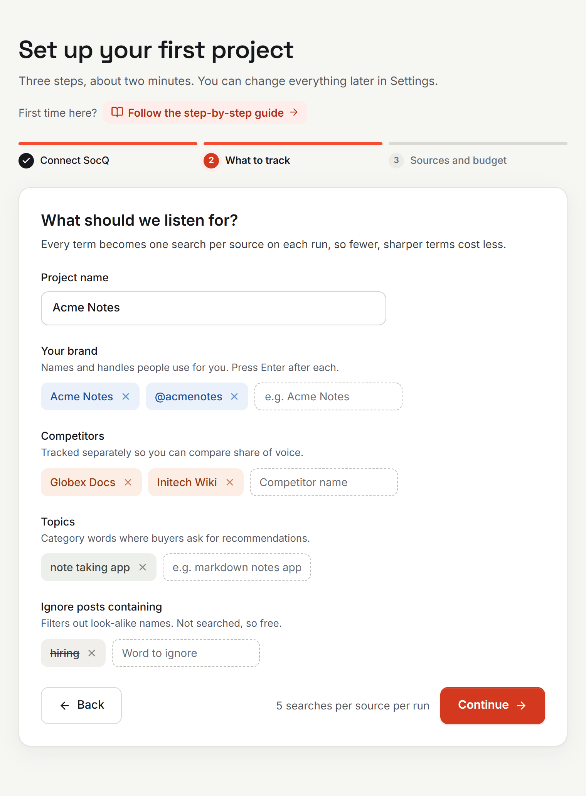
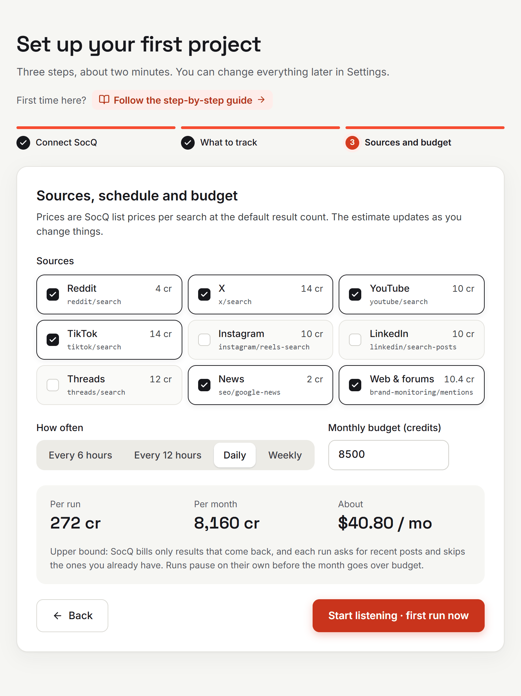
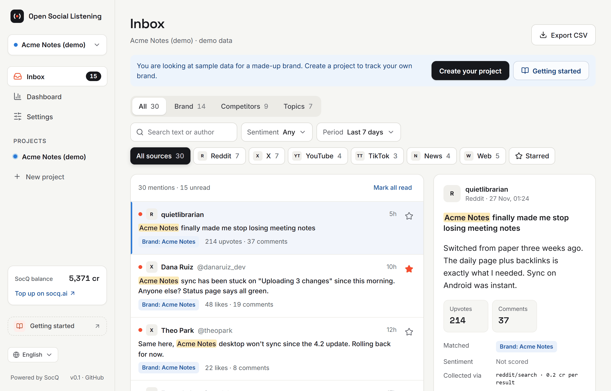
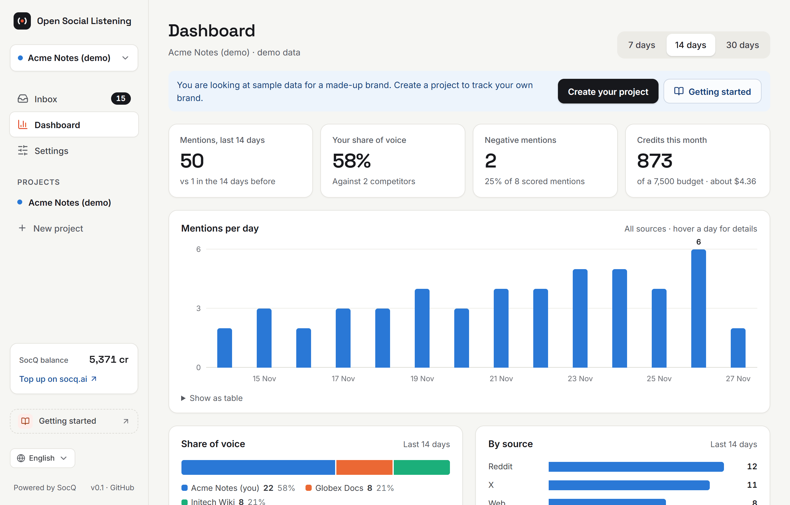
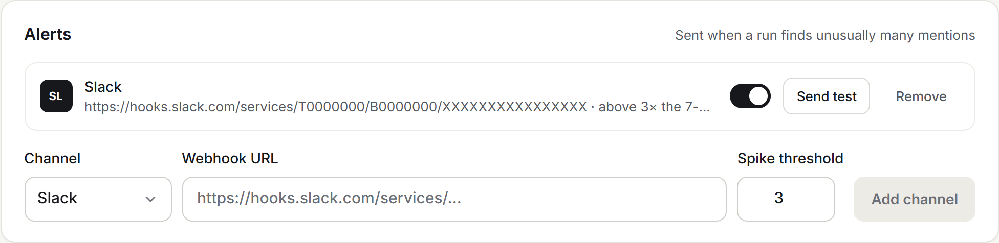

# Getting started

**English** · [简体中文](getting-started.zh-CN.md) · [日本語](getting-started.ja.md) · [Deutsch](getting-started.de.md) · [Bahasa Indonesia](getting-started.id.md)

This guide walks you from a fresh install to your first mentions and your first spike alert. It takes about ten
minutes. If Open Social Listening is not running yet, start with the [deployment guide](deploy.md), or follow along in
the [live demo](https://socqapi.github.io/open-social-listening/).

## Contents

1. [Look around the demo](#1-look-around-the-demo)
2. [Connect your SocQ account](#2-connect-your-socq-account)
3. [Choose what to track](#3-choose-what-to-track)
4. [Pick sources, a schedule and a budget](#4-pick-sources-a-schedule-and-a-budget)
5. [Work through the inbox](#5-work-through-the-inbox)
6. [Read the dashboard](#6-read-the-dashboard)
7. [Get alerts when mentions spike](#7-get-alerts-when-mentions-spike)
8. [Keep costs under control](#keep-costs-under-control)
9. [Questions](#questions)

## 1. Look around the demo

The first time you open the app, it shows **Acme Notes (demo)**, a made-up brand with sample mentions. Click through the
inbox, the dashboard and the settings to see what you will get. The demo costs nothing and never calls SocQ.

The interface follows your browser language. To change it, use the language menu at the bottom of the sidebar (at
the top on phones). English, 简体中文, 日本語, Deutsch and Bahasa Indonesia are available.

When you are ready for real data, click the button in the blue banner: **Connect SocQ**, or **Create your project** if
the server already has an API key.

## 2. Connect your SocQ account

Open Social Listening is free. It collects public posts through the [SocQ API](https://socq.ai/?utm_source=github&utm_medium=docs&utm_campaign=open-social-listening),
which charges only for the results it returns.

1. Sign in at [socq.ai](https://socq.ai/dashboard/api-key?utm_source=github&utm_medium=docs&utm_campaign=open-social-listening)
   and create a key on the **API Key** page.
2. Paste the key into **SocQ API key** and click **Test connection**.
3. The app confirms the connection and shows your credit balance. Click **Continue**.

The key is stored in the app's database on your server and is only ever sent to the SocQ API. If you set
`SOCQ_API_KEY` in `.env` on the server, this step is skipped.

## 3. Choose what to track

Each term you add becomes one search per source on every run, so a few precise terms beat many vague ones.

| Field | What to enter | Example |
| --- | --- | --- |
| **Project name** | Anything that helps you recognise it. | Acme Notes |
| **Your brand** | The names, handles and domains people actually write. | `Acme Notes`, `@acmenotes`, `acmenotes.com` |
| **Competitors** | Up to 10. Each is searched separately, so the dashboard can compare share of voice. | Globex Docs, Initech Wiki |
| **Topics** | Phrases buyers use when they look for a product like yours. | note taking app |
| **Ignore posts containing** | Words that mark unrelated posts. Posts containing them are not saved. They add no searches. | hiring, job opening |

Type a term and press **Enter** (or a comma) to add it. Click **×** on a term to remove it.

If a brand or competitor name is a single everyday word, such as "Notion" or "Linear", the app warns you: the search
would also match posts that use the word in its normal sense. Add the full product name or handle, and words to ignore.

## 4. Pick sources, a schedule and a budget

**Sources.** Reddit, X, YouTube, TikTok, news and the web (blogs and forums) are on by default. Instagram, LinkedIn and
Threads are optional. The price next to each is SocQ's list price for one search at the default 20 results.

**How often.** Every 6 hours, every 12 hours, daily or weekly. Each run looks back only as far as needed (the last day,
or the last week for weekly projects) where the platform supports it, so the first run shows recent posts rather than
years of history. Posts already collected are never charged again.

**Monthly budget.** The app suggests one from the estimate. Before a run that would go over it, the project pauses
instead of spending more. Set 0 for no limit.

**The estimate** at the bottom updates as you change anything. It is an upper bound: SocQ charges only for the results
it actually returns, and quiet terms return fewer. One credit is $0.005; a single brand on the six default sources,
checked daily, costs at most about $8 a month.

Click **Start listening · first run now**. The first run takes one to three minutes; new mentions appear in the inbox
as soon as it finishes.

## 5. Work through the inbox

- **New mentions** have an orange dot. Opening one marks it read; **Mark all read** clears the rest.
- **Filters** narrow the list by type (brand, competitors, topics), sentiment, period and source. The numbers on each
  filter are the counts for the chosen period.
- **Search** finds words in the post text and author names.
- **Star** mentions you want to come back to, then use the **Starred** filter.
- **Open original** takes you to the post on its platform.
- **Export CSV** downloads exactly what the filters show, for a spreadsheet or a report.
- **Run now** (top right) starts a run immediately, outside the schedule. Its label shows the most it can cost.

On a phone, tapping a mention opens it in a panel from the bottom of the screen.

## 6. Read the dashboard

- **The four numbers on top**: mentions in the period with the change against the period before, your share of voice,
  negative mentions, and credits used this month.
- **Mentions per day**: point at a day to see its count and the busiest source. A tall day is worth a look in the inbox.
- **Share of voice**: how often your brand is mentioned compared with each competitor.
- **By source** and **Sentiment**: where the conversation happens and how it feels. Sentiment is scored for web and forum
  mentions; social posts show "Not scored" for now.
- **Recent runs**: when each run happened, how many new mentions it found and what it cost.

Switch between 7, 14 and 30 days at the top right.

## 7. Get alerts when mentions spike

Open **Settings** and scroll to **Alerts**. Pick a channel, paste where to send it, and click **Add channel**.

| Channel | What to paste |
| --- | --- |
| **Slack** | An incoming webhook URL. In Slack, create an app, turn on **Incoming Webhooks**, add one for your channel and copy its URL. See [Slack's guide](https://api.slack.com/messaging/webhooks). |
| **Discord** | A webhook URL: channel settings → **Integrations** → **Webhooks** → **New Webhook** → **Copy Webhook URL**. |
| **Webhook** | Any URL that accepts a JSON `POST`, for Zapier, Make, n8n or your own code. |
| **Email** | An address. The server needs `SMTP_URL` and `ALERT_FROM` in `.env` (see the [deployment guide](deploy.md#3-start-open-social-listening)). |

**Spike threshold** decides what counts as a spike. With 3, a run alerts when it finds more than three times the
average new mentions per run over the last 7 days. The app needs at least three earlier runs before it can judge, so
the first alerts come after a few days. Use **Send test** to check a channel straight away.

## Keep costs under control

- **Budget.** Each project has a monthly credit budget. The sidebar shows how much of it is used. When the next run
  would go over, the project pauses and says so at the top of every page; raise the budget in **Settings** and click
  **Resume**.
- **Out of credits or key rejected.** The project pauses too. Top up on socq.ai, or replace the key in
  **Settings → SocQ connection**, then resume.
- **Fewer, sharper terms** cost less than many broad ones, and fewer results per search cost less than the default 20.
  Change both in **Settings**; the monthly estimate updates as you edit.
- **Pause** stops a project at any time without losing anything. Changes in Settings apply from the next run.

## Questions

**The inbox is empty after the first run.** Quiet terms can find nothing in the last day. Wait for a few runs, add the
spellings people really use, or switch the period filter to 30 days. **Recent runs** on the dashboard shows whether runs
succeed.

**Why are some posts unrelated?** The term also means something else. Add words that appear in those posts to
**Ignore posts containing** in Settings. From the next run on, posts containing them are not saved; mentions already in
the inbox stay.

**Can I track more than one brand?** Yes. Create one project per brand with **New project** in the sidebar, and switch
between them with the menu at the top of the sidebar.

**Where is my data?** In the SQLite database on your server. Nothing is sent anywhere except the searches to SocQ. The
[deployment guide](deploy.md#7-back-up-and-move-your-data) shows how to back it up.

**Can I get the data out?** **Export CSV** in the inbox, or JSON from the API (`GET /api/export?projectId=1&format=json`).
The [README](../README.md#api) lists every route.
