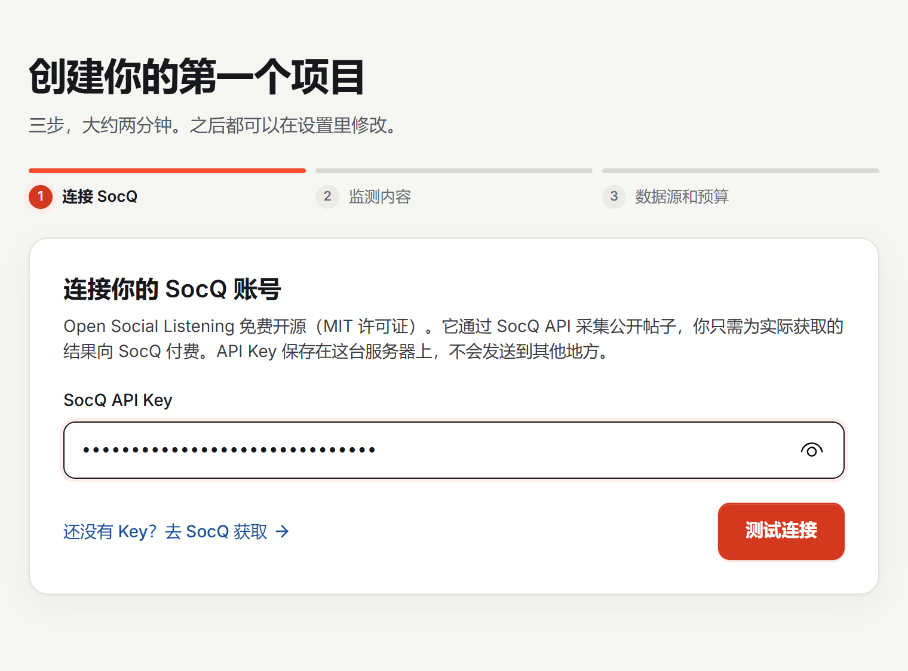
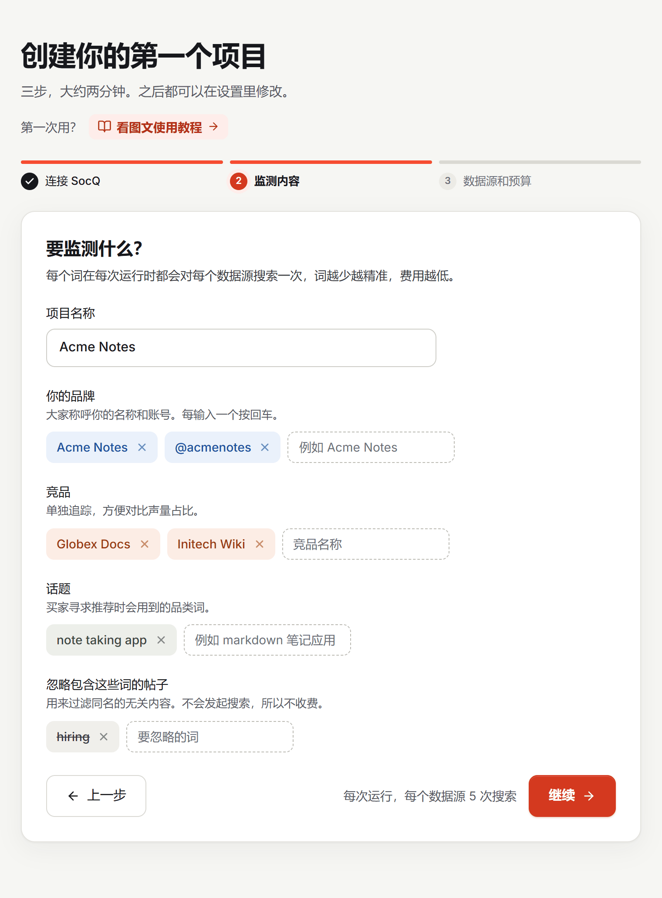
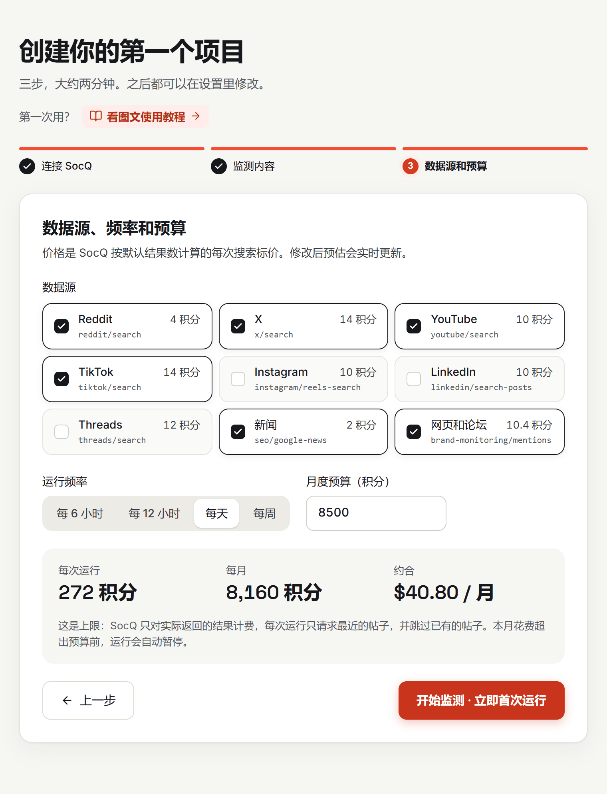
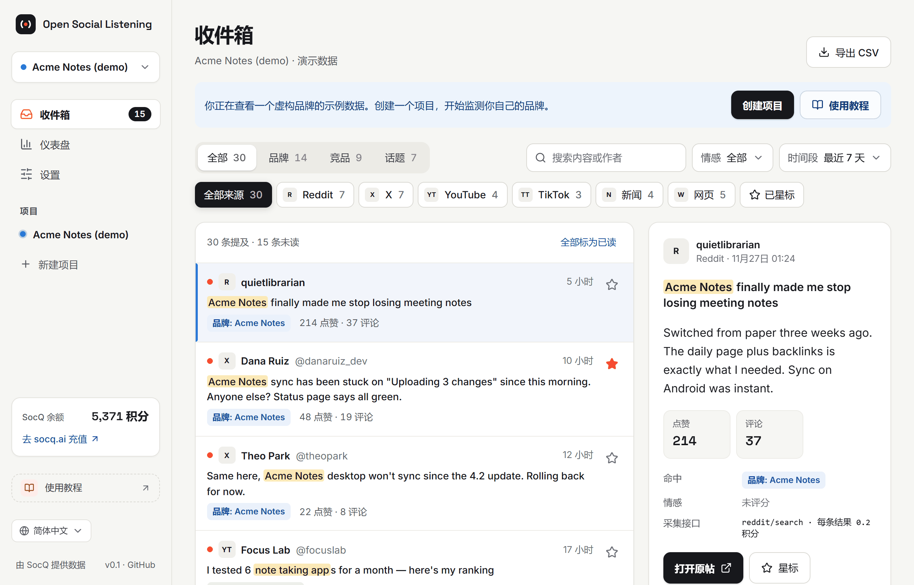
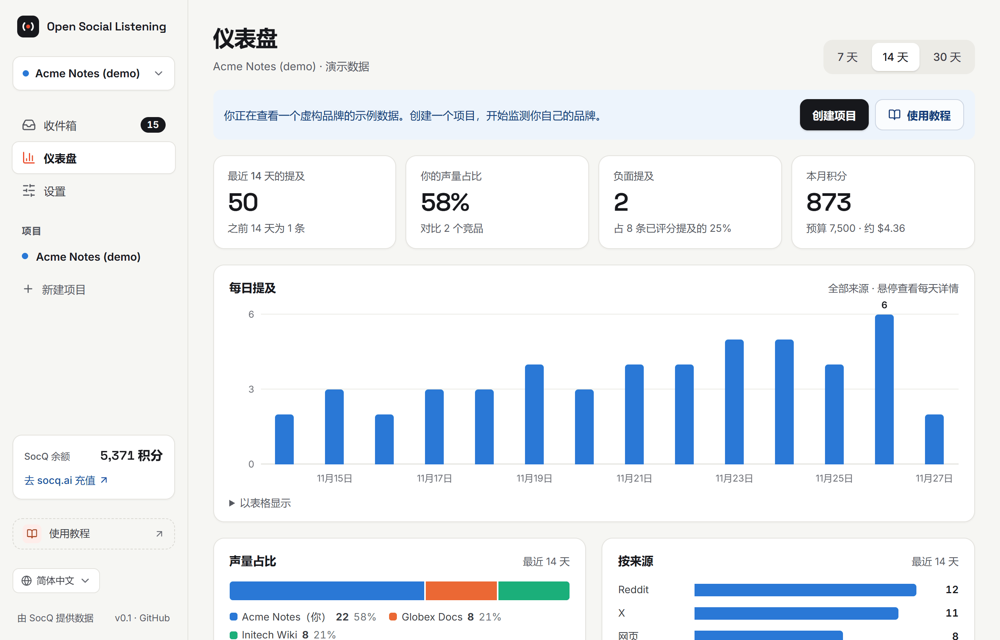
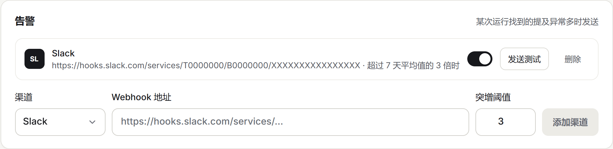

# 使用教程

[English](getting-started.md) · **简体中文** · [日本語](getting-started.ja.md) · [Deutsch](getting-started.de.md) · [Bahasa Indonesia](getting-started.id.md)

这篇教程带你从刚装好的应用开始，拿到第一批提及，并收到第一条声量突增告警，大约需要十分钟。如果 Open Social Listening 还没运行起来，先看[部署教程](deploy.zh-CN.md)，也可以对照[在线演示](https://socqapi.github.io/open-social-listening/)边看边操作。

## 目录

1. [先逛逛演示项目](#1-先逛逛演示项目)
2. [连接你的 SocQ 账号](#2-连接你的-socq-账号)
3. [选择要监测的内容](#3-选择要监测的内容)
4. [选择数据源运行频率和预算](#4-选择数据源运行频率和预算)
5. [处理收件箱](#5-处理收件箱)
6. [看懂仪表盘](#6-看懂仪表盘)
7. [声量突增时收到告警](#7-声量突增时收到告警)
8. [控制费用](#控制费用)
9. [常见问题](#常见问题)

## 1. 先逛逛演示项目

第一次打开应用时，你会看到 **Acme Notes (demo)**，这是一个虚构品牌，带有示例提及。把收件箱、仪表盘和设置都点一遍，就知道能得到什么。演示项目完全免费，不会调用 SocQ。

界面语言默认跟随浏览器。想切换的话，用侧边栏底部的语言菜单（手机上在顶部），支持 English、简体中文、日本語、Deutsch 和 Bahasa Indonesia。

准备好接入真实数据时，点蓝色横幅里的按钮：**连接 SocQ**；如果服务器上已经配置了 API Key，按钮会显示为 **创建项目**。

## 2. 连接你的 SocQ 账号

Open Social Listening 本身免费。它通过 [SocQ API](https://socq.ai/?utm_source=github&utm_medium=docs&utm_campaign=open-social-listening) 采集公开帖子，SocQ 只对实际返回的结果收费。

1. 登录 [socq.ai](https://socq.ai/dashboard/api-key?utm_source=github&utm_medium=docs&utm_campaign=open-social-listening)，在 **API Key** 页面创建一个 Key。
2. 把 Key 粘贴到 **SocQ API Key** 输入框，点 **测试连接**。
3. 应用确认连接成功，并显示你的积分余额。点 **继续**。

Key 保存在你服务器上的应用数据库里，只会发送给 SocQ API。如果你在服务器的 `.env` 里设置了 `SOCQ_API_KEY`，这一步会自动跳过。

## 3. 选择要监测的内容

你添加的每个词，每次运行时都会在每个数据源各搜索一次。所以少量精准的词，比一堆宽泛的词更好。

| 字段 | 填什么 | 示例 |
| --- | --- | --- |
| **项目名称** | 方便你自己辨认就行。 | Acme Notes |
| **你的品牌** | 大家实际会写的名称、账号和域名。 | `Acme Notes`、`@acmenotes`、`acmenotes.com` |
| **竞品** | 最多 10 个。每个竞品单独搜索，仪表盘才能对比声量占比。 | Globex Docs、Initech Wiki |
| **话题** | 买家寻找同类产品时会用的说法。 | note taking app |
| **忽略包含这些词的帖子** | 能识别无关帖子的词。包含这些词的帖子不会被保存，也不会增加搜索次数。 | hiring、job opening |

输入一个词后按 **回车**（或输入逗号）就能添加，点词条上的 **×** 可以删除。

如果品牌或竞品的名称只是一个普通单词，比如 "Notion" 或 "Linear"，应用会提醒你：搜索结果里也会混进用这个词本来意思的帖子。这时请补上完整的产品名或账号，并添加要忽略的词。

## 4. 选择数据源运行频率和预算

**数据源。** Reddit、X、YouTube、TikTok、新闻和网页（博客与论坛）默认开启，Instagram、LinkedIn 和 Threads 可选。每个数据源旁边的价格，是按默认 20 条结果计算的单次搜索标价。

**运行频率。** 每 6 小时、每 12 小时、每天或每周。在平台支持的情况下，每次运行只回看必要的时间段（最近一天；每周运行的项目是最近一周），所以第一次运行看到的是近期的帖子，而不是好几年的历史。已经采集过的帖子不会重复收费。

**月度预算。** 应用会根据预估给出一个建议值。如果某次运行会超出预算，项目会在运行前自动暂停，不再继续花费。填 0 表示不设上限。

**费用预估**在页面底部，你改动任何设置它都会实时更新。这是一个上限：SocQ 只对实际返回的结果收费，讨论少的词返回的结果也少。1 积分 = $0.005；一个品牌词、6 个默认数据源、每天运行一次，每月最多约 $8。

点 **开始监测 · 立即首次运行**。第一次运行需要一到三分钟，运行结束后新的提及就会出现在收件箱里。

## 5. 处理收件箱

- **新的提及**前面有一个橙色圆点。点开就标为已读；**全部标为已读**可以一次清掉剩下的。
- **筛选**可以按类型（品牌、竞品、话题）、情感、时间段和来源缩小范围。每个筛选项上的数字，是所选时间段内的数量。
- **搜索**会在帖子正文和作者名中查找。
- 想以后再看的提及，点 **星标**，之后用 **已星标** 筛选出来。
- **打开原帖**会跳转到帖子所在的平台。
- **导出 CSV** 会把当前筛选出的内容原样下载下来，方便做表格或报告。
- 右上角的 **立即运行** 会马上开始一次运行，不用等定时计划。按钮上显示的是这次运行最多花多少积分。

在手机上，点一条提及会从屏幕底部弹出详情面板。

## 6. 看懂仪表盘

- **顶部四个数字**：所选时间段的提及数及其与上一个时间段的对比、你的声量占比、负面提及数、本月已用积分。
- **每日提及**：鼠标指向某一天，可以看到当天的数量和提及最多的来源。某天特别高，值得去收件箱看看。
- **声量占比**：你的品牌和每个竞品被提及的比例。
- **按来源**和**情感**：讨论发生在哪里、整体态度如何。目前只有网页和论坛的提及有情感评分，社交帖子暂时显示“未评分”。
- **最近运行**：每次运行的时间、找到多少新提及、花了多少积分。

右上角可以在 7 天、14 天、30 天之间切换。

## 7. 声量突增时收到告警

打开 **设置**，滚动到 **告警**。选择一个渠道，填入发送地址，点 **添加渠道**。

| 渠道 | 填什么 |
| --- | --- |
| **Slack** | 一个 Incoming Webhook 地址。在 Slack 里创建一个应用，开启 **Incoming Webhooks**，为你的频道添加一个，然后复制地址。详见 [Slack 的说明](https://api.slack.com/messaging/webhooks)。 |
| **Discord** | 一个 Webhook 地址：频道设置 → **整合**（Integrations）→ **Webhook** → **新 Webhook** → **复制 Webhook URL**。 |
| **Webhook** | 任何能接收 JSON `POST` 请求的地址，可以接 Zapier、Make、n8n 或你自己的程序。 |
| **邮件** | 一个邮箱地址。服务器的 `.env` 里需要配置 `SMTP_URL` 和 `ALERT_FROM`（见[部署教程](deploy.zh-CN.md#3-启动-open-social-listening)）。 |

**突增阈值**决定多少算“突增”。设为 3 时，如果某次运行找到的新提及，超过最近 7 天平均每次运行新提及数的 3 倍，就会发送告警。应用至少要有 3 次历史运行才能做出判断，所以第一条告警一般要过几天才会出现。点 **发送测试** 可以马上检查渠道是否配置正确。

## 控制费用

- **预算。** 每个项目都有月度积分预算，侧边栏会显示已经用了多少。下一次运行会超出预算时，项目会自动暂停，并在每个页面顶部说明原因；在 **设置** 里调高预算后点 **恢复** 即可。
- **积分用完或 Key 被拒绝。** 项目同样会暂停。去 socq.ai 充值，或者在 **设置 → SocQ 连接** 里更换 Key，然后恢复。
- **少而精准的词**比一堆宽泛的词便宜；每次搜索的结果数调低（默认 20），费用也会降低。这两项都可以在 **设置** 里修改，月度预估会随之更新。
- **暂停**可以随时停下一个项目，不会丢失任何数据。设置里的改动从下一次运行开始生效。

## 常见问题

**第一次运行后收件箱是空的。** 讨论少的词，在最近一天里可能什么都搜不到。可以等几次运行，补充大家实际使用的写法，或者把时间段筛选切换到 30 天。仪表盘上的 **最近运行** 可以看到每次运行是否成功。

**为什么有些帖子和我无关？** 说明这个词还有别的意思。在设置里，把这些帖子中出现的词加到 **忽略包含这些词的帖子**。从下一次运行开始，包含这些词的帖子不会再被保存；收件箱里已有的提及会保留。

**能同时监测多个品牌吗？** 可以。用侧边栏的 **新建项目** 为每个品牌建一个项目，然后用侧边栏顶部的菜单切换。

**我的数据存在哪里？** 存在你服务器上的 SQLite 数据库里。除了发给 SocQ 的搜索请求，不会向任何地方发送数据。备份方法见[部署教程](deploy.zh-CN.md#7-备份和迁移数据)。

**能把数据导出来吗？** 可以在收件箱里 **导出 CSV**，也可以通过 API 获取 JSON（`GET /api/export?projectId=1&format=json`）。所有接口见 [README](../README.zh-CN.md#api)。
